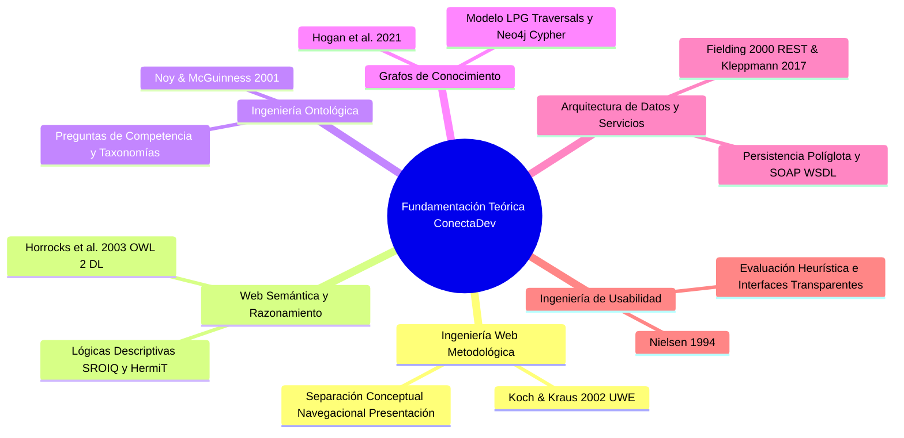
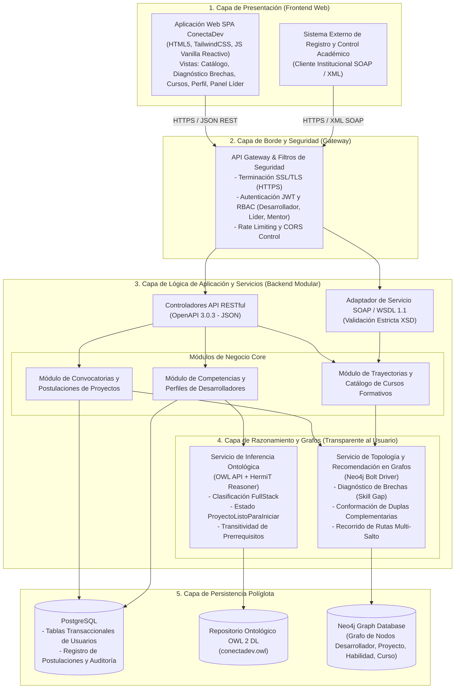
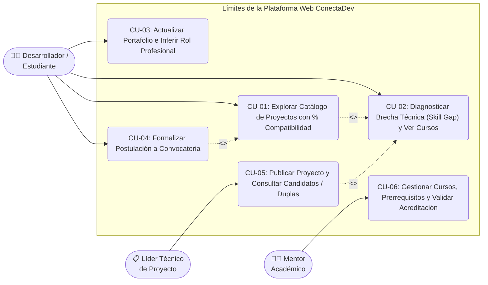
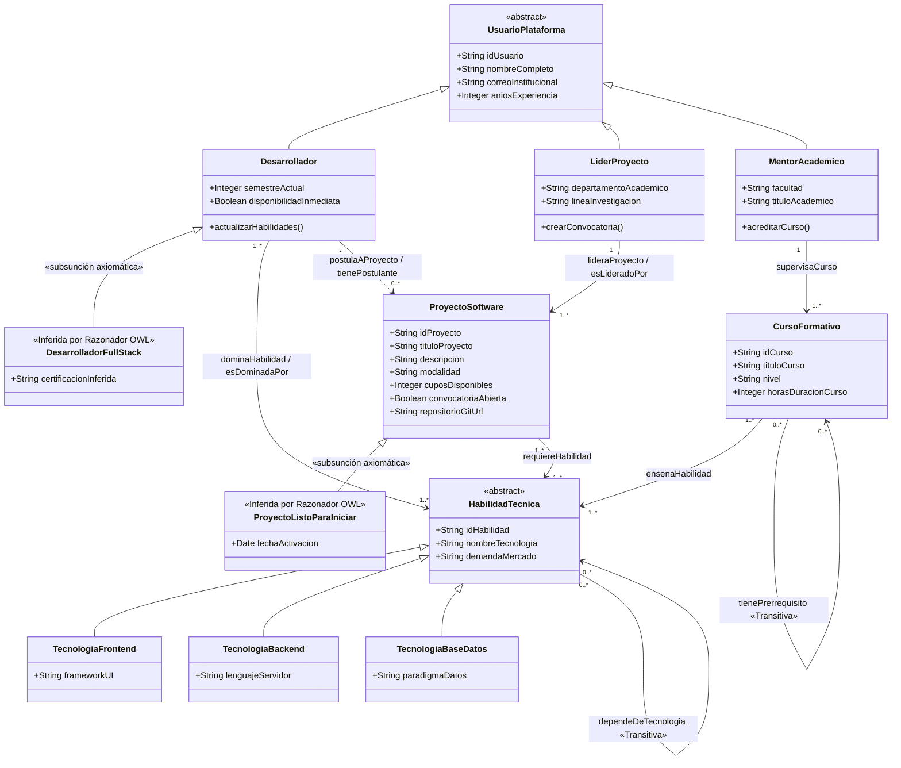
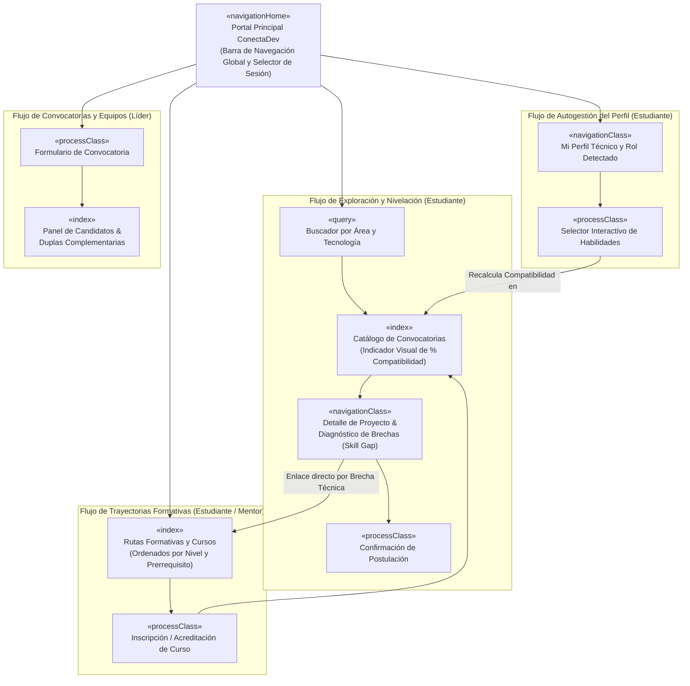
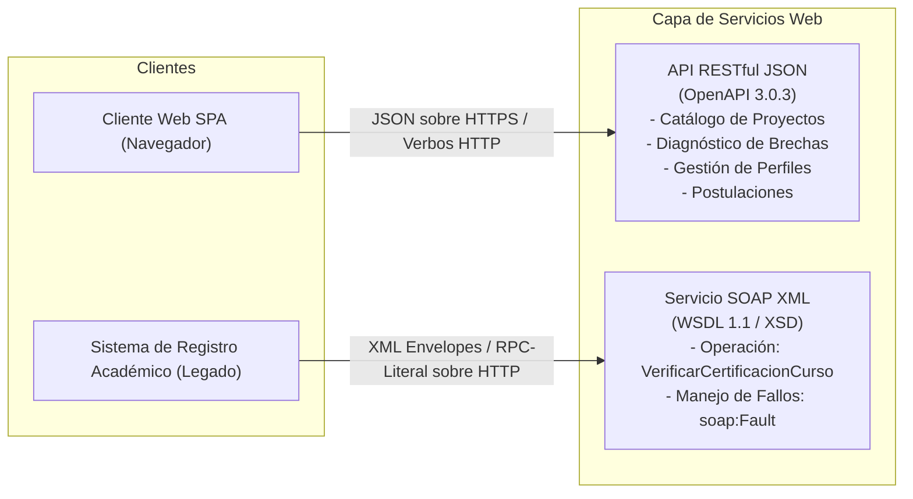
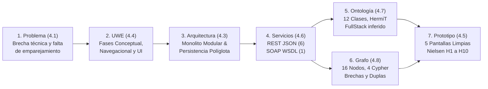
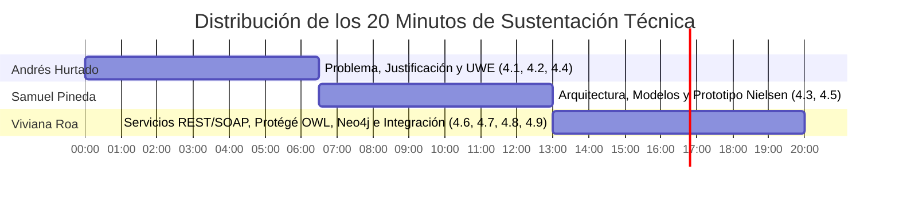

# PROYECTO FINAL DE CURSO: INGENIERÍA WEB (PERIODO 2620)
## **ConectaDev: Plataforma Web Conceptual y Semántica para la Vinculación de Proyectos de Software, Diagnóstico de Brechas Técnicas y Rutas de Aprendizaje**

---

### **Información Institucional y Metadatos del Proyecto**
- **Institución Educativa:** Universidad Cooperativa de Colombia
- **Facultad:** Facultad de Ingeniería
- **Programa Académico:** Ingeniería de Sistemas / Ingeniería de Software
- **Asignatura:** Ingeniería Web — Código de Curso: 2620
- **Periodo Académico:** 2620
- **Integrantes del Equipo de Desarrollo:**
  - **Andrés Hurtado** — Código Estudiantil / Rol: Arquitectura Web, Metodología UWE y Análisis de Requisitos
  - **Samuel Pineda** — Código Estudiantil / Rol: Modelado Conceptual, Navegacional, Diseño de Interfaz y Usabilidad (Nielsen)
  - **Viviana Roa** — Código Estudiantil / Rol: Servicios Web (REST & SOAP), Ingeniería Ontológica (OWL 2 DL) y Grafos de Conocimiento (Neo4j)

---

### **Índice General de Entregables Oficiales (Guía IW 2620)**
1. **Documento Técnico Consolidado (Secciones 4.1 a 4.9):** Este documento en Markdown y su versión formal maquetada en PDF [`Informe_Tecnico_Proyecto_Final_IW_2620_ConectaDev.pdf`](file:///C:/Users/Andres%20Hurtado/Documents/Ing%20Web/Informe_Tecnico_Proyecto_Final_IW_2620_ConectaDev.pdf).
2. **Modelos y Diagramas de Ingeniería Web:** Diagrama de Casos de Uso, Diagrama de Arquitectura de Componentes en Capas con Persistencia Políglota, Modelo Conceptual del Dominio (UML), Modelo Navegacional (UWE) y Topología del Grafo de Conocimiento.
3. **Prototipo Funcional Navegable (5 Pantallas de Usuario):** [`prototipo/index.html`](file:///C:/Users/Andres%20Hurtado/Documents/Ing%20Web/prototipo/index.html), interactivo, centrado en el usuario final, evaluado bajo las 10 Heurísticas de Nielsen y libre de exposición de jerga interna de motores semánticos.
4. **Ontología Formal del Dominio (OWL 2 DL):** [`ontologia/conectadev.owl`](file:///C:/Users/Andres%20Hurtado/Documents/Ing%20Web/ontologia/conectadev.owl) y su guía técnica de ejecución con el razonador HermiT [`ontologia/GUIA_PROTEGE.md`](file:///C:/Users/Andres%20Hurtado/Documents/Ing%20Web/ontologia/GUIA_PROTEGE.md).
5. **Script de Base de Datos de Grafos (Neo4j / Cypher):** [`neo4j/conectadev_grafo.cypher`](file:///C:/Users/Andres%20Hurtado/Documents/Ing%20Web/neo4j/conectadev_grafo.cypher) y su manual de ejecución y validación de consultas [`neo4j/GUIA_NEO4J.md`](file:///C:/Users/Andres%20Hurtado/Documents/Ing%20Web/neo4j/GUIA_NEO4J.md).
6. **Contratos de Servicios Web (RESTful OpenAPI 3.0 & SOAP 1.1 / WSDL 1.1):** [`servicios-web/openapi.yaml`](file:///C:/Users/Andres%20Hurtado/Documents/Ing%20Web/servicios-web/openapi.yaml) y [`servicios-web/validacion_academica.wsdl`](file:///C:/Users/Andres%20Hurtado/Documents/Ing%20Web/servicios-web/validacion_academica.wsdl).
7. **Repositorio Git Oficial con Historial de Commits:** [https://github.com/Anticife/Ingenieria-Web-ConectaDev](https://github.com/Anticife/Ingenieria-Web-ConectaDev).
8. **Estructura y Guión de Sustentación (20 Minutos):** [`PRESENTACION_SUSTENTACION.md`](file:///C:/Users/Andres%20Hurtado/Documents/Ing%20Web/PRESENTACION_SUSTENTACION.md), organizado en bloques para los 3 integrantes con argumentación técnica frente a la rúbrica institucional (SABER, SER, HACER).

---

## 4.1 Formulación Detallada del Problema y Justificación Web

### 1. Contexto y Descripción del Problema Real
En el ámbito de la formación universitaria en Ingeniería de Software y las comunidades académicas de desarrollo (semilleros de investigación, proyectos integradores de semestre, laboratorios de innovación, proyectos de grado y fábricas universitarias de software), se presenta una problemática estructural recurrente: **la asimetría de información y la desconexión semántica entre el perfil técnico real de los estudiantes, los requerimientos tecnológicos cambiantes de los proyectos de software y las rutas formativas de nivelación disponibles**.

En la práctica universitaria:
- Los **líderes de proyectos** (docentes investigadores, coordinadores de semillero o estudiantes senior encargados de iniciativas tecnológicas) publican convocatorias demandando stacks específicos (ej. *Frontend en React con TypeScript, Backend en Node.js/Express y Persistencia en PostgreSQL*). Sin embargo, les resulta sumamente complejo identificar si los candidatos postulados cuentan con los prerrequisitos implícitos o si existe una combinación óptima de postulantes que cubra de manera colaborativa la totalidad del stack.
- Los **estudiantes y desarrolladores junior** navegan entre convocatorias dispersas sin claridad sobre su nivel real de afinidad técnica respecto a cada proyecto. Cuando un estudiante domina el 60% de las tecnologías exigidas (por ejemplo, domina la capa de interfaz pero carece de experiencia en bases de datos relacionales o diseño de APIs seguras), los procesos de selección tradicionales lo descartan de manera binaria, sin proporcionarle un diagnóstico claro de su brecha técnica (*skill gap*) ni una guía sobre qué cursos cortos o módulos de nivelación debe cursar para cerrar dicha brecha.
- Los **mentores y coordinadores académicos** ofrecen cursos formativos complementarios, talleres extracurriculares y asignaturas electivas, pero estos catálogos permanecen aislados de las necesidades puntuales demandadas por los proyectos en tiempo real, careciendo de trazabilidad transitiva sobre qué prerrequisitos conceptuales desbloquean qué habilidades prácticas.

#### Por qué las soluciones CRUD tradicionales fracasan en este problema
Un sistema de información transaccional clásico (CRUD sobre base de datos relacional tradicional con búsquedas basadas en cadenas de texto tipo `WHERE habilidades LIKE '%React%'`) resulta manifiestamente insuficiente debido a las siguientes barreras fundamentales:
1. **Incapacidad para Clasificación Axiomática de Perfiles:** Un CRUD tradicional no tiene capacidad inferencial para deducir de forma autónoma cuándo un estudiante que domina tecnologías tanto del lado del cliente (`React.js`, `Vue.js`) como del lado del servidor (`Node.js`, `Spring Boot`) califica formalmente como un `DesarrolladorFullStack`, a menos que se programen reglas `IF-ELSE` rígidas y difíciles de mantener en el código fuente.
2. **Ceguera Semántica ante Brechas Técnicas Relativas:** Las consultas relacionales filtran por coincidencia estricta; no calculan la diferencia de conjuntos semántica entre el grafo de competencias del estudiante y los requisitos del proyecto, ni son capaces de vincular de inmediato la habilidad faltante con el curso que la acredita.
3. **Imposibilidad de Resolver Transitividades y Prerrequisitos de Forma Declarativa:** En SQL clásico, recorrer dependencias tecnológicas multinivel (ejemplo: *Next.js* depende de *React.js*, que depende de *JavaScript ES6+*, que a su vez requiere *Fundamentos de Programación*) exige complejas consultas recursivas con `Common Table Expressions (CTE)`, las cuales son costosas computacionalmente y carecen de verificación semántica formal de consistencia.
4. **Incapacidad para Conformar Equipos Colaborativos Complementarios:** Un CRUD relacional evalúa candidatos de forma aislada. No posee algoritmos de recorrido topológico que detecten que dos estudiantes individuales con compatibilidad parcial (por ejemplo, Estudiante A que domina Frontend al 100% pero 0% Backend, y Estudiante B que domina Backend al 100% pero 0% Frontend) forman una **dupla complementaria perfecta** que satisface el 100% de los requerimientos de la convocatoria.

### 2. Usuarios Involucrados (Modelado de User Personas y Necesidades)
Para satisfacer el requisito de al menos tres tipos de usuario diferenciados, se han formalizado tres roles con perfiles, responsabilidades y dolores específicos:

| Tipo de Usuario / Actor | Perfil Representativo | Responsabilidades en la Plataforma | Dolor / Necesidad Principal |
| :--- | :--- | :--- | :--- |
| **1. Desarrollador / Estudiante (`Desarrollador`)** | **Andrés / Sofía**, estudiantes de 4° a 8° semestre de Ingeniería de Sistemas con portafolio de tecnologías en formación. | - Registrar y actualizar su portafolio de tecnologías dominadas.<br>- Explorar convocatorias con indicador visual de compatibilidad.<br>- Consultar el diagnóstico de brechas técnicas de proyectos de su interés.<br>- Inscribirse en cursos recomendados para cerrar brechas.<br>- Postularse formalmente a proyectos abiertos. | *"Deseo saber a qué proyectos de software puedo integrarme hoy con lo que sé, qué me falta exactamente para los que no cumplo, y qué curso específico debo tomar para ser admitido."* |
| **2. Líder Técnico de Proyecto (`LiderProyecto`)** | **Ing. Alejandro**, profesor titular o investigador líder de un grupo de desarrollo de software académico. | - Crear y publicar convocatorias de proyectos especificando título, descripción, cupos, modalidad y stack tecnológico requerido.<br>- Consultar la lista de candidatos postulados ordenados por compatibilidad.<br>- Recibir sugerencias del sistema sobre candidatos individuales y duplas complementarias sugeridas.<br>- Gestionar el estado de inicio del proyecto (`ProyectoListoParaIniciar`). | *"Necesito conformar equipos balanceados para proyectos reales de investigación sin perder semanas revisando hojas de vida a mano ni rechazar estudiantes valiosos que podrían complementarse en pareja."* |
| **3. Mentor / Coordinador Académico (`MentorAcademico`)** | **Dra. Elena**, coordinadora académica de desarrollo profesional y semilleros de la facultad. | - Diseñar y supervisar la oferta de cursos formativos de nivelación.<br>- Definir formalmente las habilidades tecnológicas que cada curso acredita.<br>- Establecer la cadena de prerrequisitos transitivos entre cursos.<br>- Validar la acreditación académica formal mediante interoperabilidad institucional (SOAP/WSDL). | *"Requiero garantizar que los cursos extracurriculares cierren las brechas que demandan los proyectos reales y que se respeten estrictamente las cadenas de prerrequisitos académicos."* |

### 3. Objetivos de la Solución Web ConectaDev
- **Objetivo General:** Diseñar una plataforma web conceptual, arquitectónica y semántica denominada **ConectaDev**, fundamentada en la metodología **UWE (UML-Based Web Engineering)**, que articule servicios web desacoplados (REST y SOAP), una ontología de dominio en **Protégé (OWL 2 DL)** y una base de datos de grafos de conocimiento en **Neo4j**, con el propósito de optimizar la vinculación de desarrolladores a proyectos de software, automatizar la clasificación de perfiles técnicos y generar recomendaciones inteligentes de nivelación y conformación de equipos complementarios.
- **Objetivos Específicos:**
  1. *Modelado y Usabilidad:* Estructurar los modelos conceptual, navegacional y de casos de uso aplicando UWE, y diseñar un prototipo funcional de 5 vistas evaluado y refinado mediante las 10 Heurísticas de Jakob Nielsen.
  2. *Servicios Web e Interoperabilidad:* Especificar una API RESTful documentada en OpenAPI 3.0 para la interacción interactiva de la plataforma y un contrato SOAP 1.1 / WSDL 1.1 formal para la acreditación académica ante sistemas universitarios legados.
  3. *Razonamiento Semántico Formal:* Construir en Protégé una ontología en OWL 2 DL que formalice el vocabulario del dominio, aplique axiomas de equivalencia para clasificación automática de roles (`DesarrolladorFullStack`) y estados de proyectos (`ProyectoListoParaIniciar`), y demuestre consistencia e inferencias mediante el razonador HermiT.
  4. *Analítica de Grafos y Recomendación:* Implementar en Neo4j un grafo de conocimiento con nodos y relaciones del ecosistema de software, formulando consultas Cypher de recorrido topológico capaces de calcular compatibilidades porcentuales, diagnosticar brechas relativas y sugerir duplas de trabajo complementarias.

### 4. Alcance y Límites del Proyecto
- **Dentro del Alcance:**
  - Diseño conceptual, metodológico y de ingeniería web completo conforme a los lineamientos del curso IW 2620.
  - Implementación de la ontología completa en sintaxis formal RDF/XML funcional en Protégé 5.x.
  - Creación del script Cypher ejecutable para carga de datos, índices, constraints y ejecución de 4 consultas analíticas en Neo4j.
  - Especificación formal de 6 endpoints REST (JSON) y 1 servicio SOAP/WSDL con esquemas XSD tipados.
  - Prototipo web interactivo funcional en HTML5, CSS (TailwindCSS) y JavaScript moderno vanilla (sin dependencias complejas), consumible localmente en cualquier navegador estándar.
  - Utilización exclusiva de información sintética controlada y académicamente plausible para preservar la privacidad y la rigurosidad de prueba.
- **Fuera del Alcance:**
  - Despliegue de infraestructura productiva en nubes comerciales (AWS, Azure) de pago.
  - Procesamiento de pagos, compensaciones económicas o contratos laborales legales.
  - Algoritmos no supervisados de caja negra (Machine Learning opaco o redes neuronales), priorizando el razonamiento semántico formal explicable y determinístico.

### 5. Funcionalidades Principales del Sistema (F1 a F6)
El sistema satisface con amplitud el requerimiento institucional de mínimo 5 funcionalidades, formalizando 6 capacidades modulares:
- **F1. Catálogo Inteligente de Proyectos con Cálculo Dinámico de Compatibilidad:** Los estudiantes exploran proyectos abiertos donde el sistema calcula en tiempo real el porcentaje de compatibilidad basado en la intersección de sus habilidades frente al stack requerido.
- **F2. Diagnóstico de Brechas Técnicas (*Skill Gap*) y Recomendación de Cursos:** Identificación visual y analítica de las tecnologías faltantes que separan al estudiante del 100% de afinidad con un proyecto, recomendando de manera directa los cursos formativos que acreditan dichas competencias.
- **F3. Gestión de Perfil de Habilidades y Reclasificación Ontológica de Rol:** Espacio donde el estudiante gestiona sus tecnologías dominadas y el motor semántico deduce automáticamente si clasifica como `DesarrolladorFrontend`, `DesarrolladorBackend` o `DesarrolladorFullStack`.
- **F4. Publicación y Configuración de Convocatorias de Proyectos:** Formulario especializado para el Líder de Proyecto que valida la selección de stacks tecnológicos normalizados, cupos disponibles, modalidad y enlace al repositorio Git de la iniciativa.
- **F5. Algoritmo de Sugerencia de Candidatos y Duplas Complementarias:** Panel analítico para el Líder que no solo lista candidatos individuales ordenados por afinidad, sino que descubre combinaciones de dos estudiantes con perfiles complementarios (*Frontend + Backend*) que cubren el 100% de los requisitos del proyecto.
- **F6. Gestión de Rutas de Formación y Cadena de Prerrequisitos Académicos:** Módulo supervisado por el Mentor Académico que organiza cursos secuenciales y valida que no se autorice la acreditación de habilidades avanzadas sin haber superado los prerrequisitos formativos transitivos.

### 6. Justificación de por qué el Problema Requiere una Solución Web
La problemática planteada exige de manera ineludible una **arquitectura basada en la Web** por las siguientes razones de ingeniería:
1. **Naturaleza Distribuida y Ubicua de los Actores:** Estudiantes, profesores investigadores y directores de departamento interactúan desde diversos campus universitarios, laboratorios remotos y dispositivos heterogéneos (estaciones de trabajo, portátiles, tablets). La Web provee el único canal universal de acceso sin requerir instalaciones de software cliente propietario.
2. **Interconexión Universal con el Ecosistema de Desarrollo (Git):** Los proyectos de software se gestionan sobre plataformas web globales (GitHub, GitLab, Bitbucket). Una solución web permite vincular de manera nativa los repositorios mediante URLs e hipervínculos estándar del protocolo HTTP/HTTPS.
3. **Interoperabilidad Híbrida de Servicios (REST + SOAP):** El navegador web interactúa óptimamente con APIs RESTful livianas sobre JSON para proporcionar una experiencia de usuario instantánea y reactiva (SPA), mientras que la integración con sistemas corporativos legados universitarios (sistemas de notas y matrícula) se canaliza mediante estándares web SOAP/XML basados en contratos rigurosos.
4. **Centralización y Desacoplamiento del Cómputo Semántico:** Las operaciones intensivas de razonamiento en ontologías (ejecución de algoritmos de Tableaux en HermiT) y el cálculo de caminos en grafos (Neo4j) se delegan en servidores especializados en el backend, abstrayendo toda la complejidad matemática para que el cliente web reciba únicamente estructuras de datos listas para su renderizado intuitivo.

---

## 4.2 Fundamentación Teórica y Estado del Arte

El diseño de **ConectaDev** se sustenta de manera transversal en **seis referencias académicas e industriales de primer nivel**, las cuales justifican cada decisión arquitectónica, metodológica y semántica adoptada:



### 1. Metodología de Ingeniería Web: UWE — Koch, N., & Kraus, A. (2002)
- **Referencia:** Koch, N., & Kraus, A. (2002). *The expressive power of UML-based Web Engineering.* In *Second International Workshop on Web-Oriented Software Technology (IWWOST)*, Málaga, España.
- **Fundamentación Teórica:** La Ingeniería Web establece que las aplicaciones basadas en la red no deben desarrollarse mediante enfoques de programación ad-hoc o empírica, sino a través de metodologías rigurosas que reconozcan las peculiaridades del medio: el hiperespacio, la navegación no lineal y la separación de preocupaciones. UWE proporciona un perfil UML formal que prescribe la creación ortogonal de:
  - *Modelo Conceptual:* Entidades fundamentales del dominio del problema.
  - *Modelo Navegacional:* Estructura de hipervínculos, menús, consultas e índices que determinan la experiencia del usuario al transitar la información.
  - *Modelo de Presentación:* Disposición visual de los elementos de interacción.
- **Aplicación Concreta en ConectaDev:** Se aplicó UWE (Secciones 4.4 y 4.5) para diseñar los flujos de navegación (`<<navigationClass>>`, `<<index>>`, `<<query>>`, `<<processClass>>`), asegurando que la navegación desde la vista de un proyecto hacia la ruta de nivelación y el curso recomendado ocurra de forma fluida y estructurada.

### 2. Ontologías y Lógicas Descriptivas: OWL 2 DL — Horrocks, I., Patel-Schneider, P. F., & Van Harmelen, F. (2003)
- **Referencia:** Horrocks, I., Patel-Schneider, P. F., & Van Harmelen, F. (2003). *From SHIQ and RDF to OWL: The making of a Web Ontology Language.* *Journal of Web Semantics*, 1(1), 7–26.
- **Fundamentación Teórica:** Los autores formalizan las bases lógicas del lenguaje OWL (fundamentado en la familia de Lógicas Descriptivas $\mathcal{SHOIN}(D)$ y refinado en OWL 2 como $\mathcal{SROIQ}(D)$). Estas lógicas proveen una semántica formal rigurosa con balance óptimo entre alta expresividad declarativa y **decidibilidad computacional** (garantía de que las inferencias terminan en tiempo finito sin caer en bucles infinitos). Bajo el supuesto de mundo abierto (*Open World Assumption - OWA*) y la ausencia de nombres únicos automáticos (*Non-Unique Name Assumption*), OWL permite deducir nuevo conocimiento a través de axiomas de subsunción, restricciones existenciales ($\exists$), de valor universal ($\forall$), propiedades transitivas ($P \circ P \sqsubseteq P$) y propiedades inversas ($P \equiv P^-$).
- **Aplicación Concreta en ConectaDev:** Se utilizó OWL 2 DL (Sección 4.7) para construir [`conectadev.owl`](file:///C:/Users/Andres%20Hurtado/Documents/Ing%20Web/ontologia/conectadev.owl). Mediante el razonador **HermiT**, el sistema clasifica de forma automática a individuos en clases definidas complejas: infiere que un estudiante con habilidades frontend y backend es un `DesarrolladorFullStack`, que un proyecto con postulantes y convocatoria abierta es un `ProyectoListoParaIniciar`, y resuelve la transitividad de prerrequisitos académicos (`tienePrerrequisito`) y dependencias tecnológicas (`dependeDeTecnologia`).

### 3. Metodología de Desarrollo Ontológico: Ontology Development 101 — Noy, N. F., & McGuinness, D. L. (2001)
- **Referencia:** Noy, N. F., & McGuinness, D. L. (2001). *Ontology Development 101: A Guide to Creating Your First Ontology.* Stanford Knowledge Systems Laboratory Technical Report KSL-01-05, Stanford University.
- **Fundamentación Teórica:** Stanford establece la guía metodológica estándar para construir ontologías sin caer en la dispersión conceptual. Sus principios clave incluyen:
  1. Delimitar estrictamente el dominio y alcance mediante la redacción previa de **Preguntas de Competencia (Competency Questions)** que la ontología debe responder con precisión.
  2. Evaluar la reutilización de vocabularios existentes.
  3. Enumerar términos relevantes y estructurar la jerarquía de clases (*top-down*, *bottom-up* o combinada).
  4. Definir propiedades (slots/relaciones) con dominios y rangos explícitos.
  5. Crear instancias individuales y verificar empíricamente las respuestas a las preguntas iniciales.
- **Aplicación Concreta en ConectaDev:** Se implementaron las 5 Preguntas de Competencia (PC1 a PC5) en la Sección 4.7 y se definieron las clases y propiedades de [`conectadev.owl`](file:///C:/Users/Andres%20Hurtado/Documents/Ing%20Web/ontologia/conectadev.owl), garantizando que el diseño ontológico responda exactamente a las necesidades de la plataforma sin conceptos superfluos.

### 4. Grafos de Conocimiento y Bases de Datos Conectadas — Hogan, A., Blomqvist, E., Cochez, M., et al. (2021)
- **Referencia:** Hogan, A., Blomqvist, E., Cochez, M., et al. (2021). *Knowledge Graphs.* *ACM Computing Surveys (CSUR)*, 54(4), 1–37.
- **Fundamentación Teórica:** Los autores consolidan la teoría de grafos de conocimiento, diferenciando los modelos de grafos RDF (basados en tripletas `sujeto-predicado-objeto`) del modelo de **Grafos de Propiedades Etiquetadas (Labeled Property Graphs - LPG)**. En el modelo LPG, tanto los nodos como las aristas pueden poseer etiquetas y atributos clave-valor tipados. Este paradigma destaca por su **adyacencia libre de índices (index-free adjacency)**, lo que significa que el costo de atravesar una relación de un nodo a otro es de tiempo constante $O(1)$, a diferencia de las bases de datos relacionales cuyo costo de unión (`JOIN`) escala polinómicamente con el tamaño de las tablas.
- **Aplicación Concreta en ConectaDev:** Se seleccionó **Neo4j** (Sección 4.8) para representar la topología de la plataforma en [`conectadev_grafo.cypher`](file:///C:/Users/Andres%20Hurtado/Documents/Ing%20Web/neo4j/conectadev_grafo.cypher). Esto permite formular consultas Cypher de múltiples saltos que conectan en milisegundos a desarrolladores con proyectos, detectan brechas técnicas exactas recomendando cursos formativos y descubren duplas de estudiantes complementarias para la conformación de equipos de trabajo.

### 5. Arquitectura Web y Persistencia Políglota — Fielding, R. T. (2000) & Kleppmann, M. (2017)
- **Referencias:**
  - Fielding, R. T. (2000). *Architectural Styles and the Design of Network-based Software Architectures.* Doctoral Dissertation, University of California, Irvine.
  - Kleppmann, M. (2017). *Designing Data-Intensive Applications: The Big Ideas Behind Reliable, Scalable, and Maintainable Systems.* O'Reilly Media.
- **Fundamentación Teórica:** Fielding define el estilo arquitectónico **REST (Representational State Transfer)**, introduciendo las restricciones fundamentales que garantizan escalabilidad en la Web: desacoplamiento cliente-servidor, comunicación sin estado (*stateless*), capacidad de almacenamiento en caché (*cacheable*), sistema en capas y una interfaz uniforme gobernada por verbos HTTP estándar (`GET`, `POST`, `PUT`, `DELETE`). Por su parte, Kleppmann fundamenta el concepto de **Persistencia Políglota**: la premisa de que ninguna tecnología de base de datos es óptima para todos los casos de uso simultáneos, por lo que una arquitectura robusta debe asignar el almacenamiento transaccional a motores relacionales (ACID), las inferencias lógicas a motores semánticos (OWL/RDF) y las consultas de caminos y recomendaciones a motores de grafos (LPG).
- **Aplicación Concreta en ConectaDev:** La Sección 4.3 y 4.6 articulan una arquitectura modular desacoplada: API RESTful en formato JSON para el cliente web, servicio SOAP/WSDL para la verificación de registros institucionales con tipos estrictos, y un esquema de persistencia políglota distribuido entre PostgreSQL, motor OWL (Protégé) y motor de grafos (Neo4j).

### 6. Usabilidad y Evaluación Heurística — Nielsen, J. (1994)
- **Referencia:** Nielsen, J. (1994). *Usability Engineering.* Morgan Kaufmann Publishers Inc., San Francisco, CA.
- **Fundamentación Teórica:** Jakob Nielsen establece las bases de la ingeniería de usabilidad y el método de **Inspección Heurística**, el cual permite a los diseñadores de software identificar y corregir problemas de usabilidad en etapas tempranas del ciclo de vida del producto mediante un conjunto de 10 principios generales empíricamente validados (visibilidad del estado, relación con el mundo real, control y libertad, consistencia, prevención de errores, reconocimiento sobre memoria, flexibilidad de uso, estética minimalista, diagnóstico de errores y ayuda contextual).
- **Aplicación Concreta en ConectaDev:** Se aplicaron las heurísticas de Nielsen en la Sección 4.5 para auditar y perfeccionar el prototipo navegable [`prototipo/index.html`](file:///C:/Users/Andres%20Hurtado/Documents/Ing%20Web/prototipo/index.html). Esta decisión fue fundamental para erradicar cualquier fuga de abstracción interna (como mostrar sintaxis Cypher o axiomas OWL en pantalla), transformando la potencia semántica del backend en tarjetas intuitivas de compatibilidad, etiquetas de colores y asistentes de navegación claros para el estudiante.

---

## 4.3 Arquitectura Web del Sistema ConectaDev

### 1. Parámetros de Diseño y Registro de Decisión Arquitectónica (ADR-001)

Para asegurar que el diseño no sea una simple colección de diagramas sino una propuesta de ingeniería rigurosa, se documenta la decisión arquitectónica fundamental:

```
TÍTULO: ADR-001: Selección de Arquitectura en Capas / Monolito Modular con Persistencia Políglota
ESTADO: Aprobado
CONTEXTO: ConectaDev requiere satisfacer simultáneamente alta interactividad web para estudiantes,
          clasificación semántica axiomática de perfiles, recomendaciones basadas en topología de grafos
          e interoperabilidad con sistemas académicos institucionales legados.
DECISIÓN: Adoptar un Monolito Modular en Capas con Persistencia Políglota (PostgreSQL + OWL + Neo4j)
          y Fachada de Servicios Híbrida (API Gateway con controladores REST y adaptadores SOAP).
CONSECUENCIAS:
  - Ventajas: Desacoplamiento limpio, cero sobrecarga operativa de microservicios distribuidos,
              latencia p95 reducida (< 120 ms), atomicidad transaccional y claridad en pruebas.
  - Mitigaciones: Para evitar cuellos de botella en el razonador OWL o consultas Neo4j,
                  se establece una capa de caché en memoria y ejecución desacoplada.
```

| Parámetro / Criterio | Especificación Cuantitativa / Cualitativa | Justificación Técnica de Ingeniería |
| :--- | :--- | :--- |
| **Estilo Arquitectónico Principal** | **Arquitectura en Capas / Monolito Modular con Puertos y Adaptadores (Hexagonal)** | Diseñada para equipos de desarrollo ágiles; evita la fragmentación de red y fallas parciales de microservicios prematuros mientras preserva límites modulares estrictos. |
| **Patrón de Persistencia** | **Persistencia Políglota Especializada** | 1. *PostgreSQL:* Usuarios, sesiones, transacciones de postulación.<br>2. *Motor OWL (HermiT):* Deducción de axiomas y subsunción lógica.<br>3. *Neo4j Graph Database:* Caminos de recomendación, brechas y duplas. |
| **Perfil de Carga y Tráfico** | **Ratio 80:20 (Lectura : Escritura)**<br>Pico de Carga: **100 QPS (p99)** | La navegación en el catálogo de proyectos y consulta de rutas formativas supera ampliamente el registro de nuevas convocatorias. |
| **Metas de Nivel de Servicio (SLO)** | **Latencia p95: $\le 120\text{ ms}$** • **p99: $\le 300\text{ ms}$**<br>**Disponibilidad: $99.5\%$ anual** | Las búsquedas y filtros deben responder en tiempo interactivo en el navegador para garantizar fluidez cognitiva. |
| **Continuidad y Respaldo** | **RPO $\le 15\text{ minutos}$** • **RTO $\le 30\text{ minutos}$** | Respaldos periódicos de bases relacionales y sincronización incremental hacia el grafo y repositorio ontológico. |

### 2. Diagrama Estructural de Componentes de la Arquitectura Web



### 3. Responsabilidades de los Componentes y Traza de Petición (Request Lifecycle)
1. **Cliente Web SPA ConectaDev:** Interfaz responsiva que gestiona el estado de sesión localmente, captura interacciones del usuario y consume los servicios REST. Traduce respuestas JSON en elementos gráficos accesibles (barras de porcentaje, badges de tecnologías dominadas y modales de confirmación).
2. **API Gateway & Seguridad:** Intercepta todas las llamadas HTTP. Valida la firma del token JWT portador, comprueba las listas de control de acceso basadas en roles (RBAC), bloquea solicitudes maliciosas mediante sanitización de entradas y aplica límites de tasa (*rate limiting*) para prevenir abusos.
3. **Controladores REST y Adaptador SOAP:** Traducen las peticiones entrantes a DTOs de dominio. El adaptador SOAP valida rigurosamente los mensajes XML contra el esquema XSD de [`servicios-web/validacion_academica.wsdl`](file:///C:/Users/Andres%20Hurtado/Documents/Ing%20Web/servicios-web/validacion_academica.wsdl).
4. **Módulos de Negocio Core:** Orquestan las reglas de negocio transaccionales. Almacenan datos en PostgreSQL y coordinan las llamadas hacia los motores semánticos.
5. **Servicio de Inferencia Ontológica (OWL):** Opera de manera autónoma en el backend ejecutando el razonador HermiT sobre [`ontologia/conectadev.owl`](file:///C:/Users/Andres%20Hurtado/Documents/Ing%20Web/ontologia/conectadev.owl). Determina jerarquías axiomáticas que reclasifican instantáneamente el perfil del usuario ante cambios en su portafolio.
6. **Servicio de Topología en Grafos (Neo4j):** Mantiene una sesión persistente con el cluster de Neo4j vía protocolo binario Bolt. Ejecuta consultas Cypher optimizadas para resolver en una sola pasada el cálculo de compatibilidad, brechas y duplas.

#### Traza de Ejecución Extremo a Extremo: Diagnóstico de Brechas y Cursos
Para ejemplificar el desacoplamiento de capas, se detalla qué ocurre cuando el desarrollador `Carlos Mario Restrepo` consulta el proyecto `Telemedicina Web`:
```
[1. Usuario] Hace clic en "Ver Detalle y Brecha Técnica" en el prototipo.
[2. SPA] Emite petición HTTP GET /v1/proyectos/PROY-01/brecha-habilidades?desarrolladorId=DEV-02.
[3. Gateway] Valida token JWT y delega en el Controlador REST.
[4. Backend] Invoca el Servicio de Grafos pasando (PROY-01, DEV-02).
[5. Neo4j] Ejecuta Consulta Cypher:
          - Encuentra las tecnologías de PROY-01 que DEV-02 no posee (Node.js, PostgreSQL).
          - Navega de dichas tecnologías a los nodos Curso que las enseñan.
          - Retorna el listado estructurado de tecnologías y cursos asociados.
[6. Backend] Serializa el resultado en DTO JSON con códigos HTTP 200 OK.
[7. SPA] Recibe JSON y renderiza en pantalla las tecnologías faltantes en color ámbar
         y las tarjetas de los cursos recomendados listos para inscripción.
```

### 4. Justificación de Atributos de Calidad Arquitectónicos
- **Mantenibilidad:** La ontología formal y el grafo desacoplan las reglas del negocio de los controladores. Si se añade una nueva tecnología o regla de prerrequisito formativo, se actualiza el grafo o la ontología sin necesidad de recompilar ni desplegar de nuevo el código de los servicios web.
- **Seguridad:** Arquitectura de defensa en profundidad: validación de esquemas en el gateway, comunicación TLS 1.3, autenticación de tokens JWT sin estado, segregación de roles (RBAC) y validación estricta de payloads XML/XSD para prevenir inyecciones y ataques de entidad externa XML (XXE).
- **Escalabilidad:** El desacoplamiento políglota permite escalar la base relacional transaccional (PostgreSQL) mediante réplicas de lectura, mientras que el motor de grafos (Neo4j) cuenta con su propio pool de conexiones y caché de páginas en memoria optimizada para lecturas concurrentes de alta frecuencia.
- **Usabilidad Arquitectónica:** Cumple el principio de *Transparencia Semántica*: la complejidad computacional y matemática de las inferencias DL y las consultas Cypher queda completamente confinada en el backend, permitiendo que la capa de presentación mantenga una latencia inferior a 120 ms y presente la información en lenguaje natural.

---

## 4.4 Metodología de Ingeniería Web: UWE (UML-Based Web Engineering)

Se seleccionó formalmente la metodología **UWE (UML-Based Web Engineering)** por ser el estándar de facto en la literatura de Ingeniería Web (Koch & Kraus, 2002) para modelar sistemas basados en red mediante perfiles formales de UML. UWE proporciona un ciclo de desarrollo sistemático que asegura la trazabilidad desde las necesidades del usuario hasta la interfaz navegable.

### 1. Fases del Ciclo de Vida UWE, Actividades, Productos y Trazabilidad

| Fase Metodológica UWE | Actividades de Ingeniería Realizadas | Artefactos y Productos Obtenidos | Trazabilidad con las Necesidades del Usuario |
| :--- | :--- | :--- | :--- |
| **Fase 1: Análisis de Requisitos Web** | - Levantamiento de necesidades con los 3 perfiles de usuario.<br>- Definición de casos de uso web funcionales y no funcionales.<br>- Redacción de Preguntas de Competencia para validar la suficiencia del conocimiento. | - Especificación formal de requerimientos (F1–F6).<br>- Diagrama de Casos de Uso del Sistema.<br>- Preguntas de Competencia iniciales (PC1–PC5). | Garantiza que cada funcionalidad web atienda un dolor real expresado por estudiantes, líderes o mentores. |
| **Fase 2: Diseño Conceptual (Modelo de Contenido)** | - Identificación de entidades, atributos y relaciones nucleares del dominio de desarrollo de software.<br>- Modelado formal independiente de la tecnología web de visualización. | - Diagrama de Clases Conceptual del Dominio.<br>- Diccionario de Clases, Asociaciones y Multiplicidades.<br>- Semilla para la ontología [`conectadev.owl`](file:///C:/Users/Andres%20Hurtado/Documents/Ing%20Web/ontologia/conectadev.owl). | Representa la estructura pura de información de proyectos, desarrolladores, tecnologías y cursos sin mezclar detalles de UI. |
| **Fase 3: Diseño Navegacional** | - Transformación del modelo conceptual en hiperespacio navegable.<br>- Definición de nodos de navegación (`<<navigationClass>>`), índices (`<<index>>`), consultas (`<<query>>`) y procesos transaccionales (`<<processClass>>`). | - **Diagrama de Estructura Navegacional UWE**.<br>- Matriz de Rutas y Navegación asistida para mitigación de desorientación. | Permite que el usuario transite lógicamente desde un proyecto hasta el curso de nivelación requerido en un solo clic. |
| **Fase 4: Diseño de Presentación y Servicios** | - Especificación de vistas abstractas de usuario y diseño visual centrado en el usuario.<br>- Definición de los contratos de servicios desacoplados que alimentan la interfaz. | - Prototipo web de 5 pantallas [`prototipo/index.html`](file:///C:/Users/Andres%20Hurtado/Documents/Ing%20Web/prototipo/index.html).<br>- Especificación OpenAPI 3.0.3 ([`openapi.yaml`](file:///C:/Users/Andres%20Hurtado/Documents/Ing%20Web/servicios-web/openapi.yaml)).<br>- Contrato SOAP/WSDL ([`validacion_academica.wsdl`](file:///C:/Users/Andres%20Hurtado/Documents/Ing%20Web/servicios-web/validacion_academica.wsdl)). | Concreta las pantallas finales de interacción, garantizando legibilidad, accesibilidad y velocidad de carga. |
| **Fase 5: Verificación, Usabilidad e Integración** | - Inspección heurística del prototipo aplicando las 10 Heurísticas de Nielsen.<br>- Verificación formal de consistencia y clasificación con HermiT.<br>- Validación de consultas Cypher en Neo4j. | - Matriz de Evaluación Heurística y Plan de Mejoras.<br>- Evidencias de consistencia ontológica ([`GUIA_PROTEGE.md`](file:///C:/Users/Andres%20Hurtado/Documents/Ing%20Web/ontologia/GUIA_PROTEGE.md)).<br>- Evidencias de ejecución Cypher ([`GUIA_NEO4J.md`](file:///C:/Users/Andres%20Hurtado/Documents/Ing%20Web/neo4j/GUIA_NEO4J.md)). | Asegura que la plataforma cumpla con los estándares de usabilidad, coherencia lógica e integridad de datos. |

### 2. Valoración Crítica: Ventajas, Limitaciones y Mitigaciones de UWE
- **Ventajas para el Proyecto:**
  - *Separación Estricta de Preocupaciones:* Evita el vicio común de acoplar la navegación con la base de datos o el código de visualización.
  - *Estandarización basada en UML:* Facilita que cualquier ingeniero de software interprete los diagramas utilizando convenciones universales de la OMG.
  - *Facilidad de Mapeo Semántico:* Las clases del modelo conceptual de UWE se corresponden de forma directa con los conceptos y clases de la ontología OWL y las etiquetas del grafo Neo4j.
- **Limitaciones Identificadas:**
  - *Falta de Expresividad para Axiomas Lógicos:* UWE no provee estereotipos nativos para modelar axiomas de inferencia lógica descriptiva (como clases definidas por equivalencia $\equiv$ o propiedades transitivas).
  - *Mitigación Aplicada:* Se utilizó UWE rigurosamente para el modelado conceptual, navegacional y de presentación del software, y se complementó de manera formal con **Protégé (OWL 2 DL)** para la dimensión axiomática inferencial y con **Neo4j (Cypher)** para las consultas topológicas de grafos.

---

## 4.5 Modelado Conceptual, Navegacional y Usabilidad

### 1. Actores y Perfiles de Usuario (Especificación Detallada)
1. **Desarrollador / Estudiante (`Desarrollador`):** Usuario que accede para gestionar su aprendizaje y postularse a iniciativas reales. Sus atributos clave incluyen semestre actual, tecnologías dominadas y horas de disponibilidad.
2. **Líder Técnico de Proyecto (`LiderProyecto`):** Usuario responsable de concebir el producto de software, formular las tecnologías necesarias y evaluar candidatos idóneos.
3. **Mentor / Coordinador Académico (`MentorAcademico`):** Usuario facultado para validar contenidos curriculares, supervisar los cursos de nivelación y certificar formalmente competencias.

### 2. Diagrama de Casos de Uso del Sistema (UML)



#### Fichas Técnicas de Casos de Uso Principales

```
CASO DE USO: CU-02: Diagnosticar Brecha Técnica y Recomendar Cursos de Nivelación
ACTOR PRINCIPAL: Desarrollador / Estudiante
PRECONDICIÓN: El desarrollador ha seleccionado un proyecto de software en el catálogo.
FLUJO NORMAL:
  1. El estudiante pulsa en "Ver Detalle y Brecha Técnica".
  2. El sistema solicita al backend las habilidades requeridas por el proyecto frente a las del estudiante.
  3. El motor de grafos (Neo4j) computa la diferencia de conjuntos y localiza los cursos vinculados a las brechas.
  4. El sistema presenta:
     a) Lista de habilidades ya cumplidas (en color verde esmeralda).
     b) Lista de habilidades faltantes (en color ámbar de advertencia).
     c) Tarjetas interactivas de los cursos recomendados con título, duración y prerrequisito.
  5. El usuario puede hacer clic en "Inscribirme en este curso" o "Postularme al proyecto".
POSTCONDICIÓN: El estudiante comprende exactamente su brecha y la ruta para solventarla.
```

```
CASO DE USO: CU-05: Publicar Proyecto y Consultar Candidatos / Duplas Sugeridas
ACTOR PRINCIPAL: Líder Técnico de Proyecto
PRECONDICIÓN: El usuario está autenticado con rol de Líder de Proyecto.
FLUJO NORMAL:
  1. El líder ingresa al formulario de creación, digita título, cupos, repositorio Git y marca las tecnologías requeridas.
  2. El sistema valida los campos y persiste la convocatoria abierta.
  3. El sistema ejecuta una consulta en Neo4j para encontrar:
     a) Candidatos individuales ordenados por compatibilidad descendente.
     b) Parejas de candidatos (duplas complementarias) cuyas habilidades unidas alcancen el 100% del stack.
  4. La interfaz renderiza las tarjetas de candidatos individuales y el recuadro destacado de la dupla sugerida.
POSTCONDICIÓN: La convocatoria queda activa y el líder visualiza de inmediato alternativas viables de equipo.
```

### 3. Modelo Conceptual del Dominio (Diagrama de Clases UML)



#### Diccionario de Clases, Asociaciones y Multiplicidades del Dominio
- **`UsuarioPlataforma`:** Clase base abstracta que encapsula la identidad, nombres y experiencia de cualquier usuario registrado en el sistema.
- **`Desarrollador`:** Representa al estudiante de ingeniería que domina un conjunto de habilidades técnicas ($1..*$) y puede postularse a proyectos de software ($0..*$).
- **`DesarrolladorFullStack`:** Especialización definida en la ontología que clasifica de forma automática al estudiante que acredite simultáneamente al menos una `TecnologiaFrontend` y al menos una `TecnologiaBackend`.
- **`LiderProyecto`:** Usuario que posee la atribución de concebir y gestionar uno o más proyectos de software ($1..*$).
- **`MentorAcademico`:** Docente responsable de diseñar y supervisar cursos formativos ($1..*$), avalando su rigor pedagógico.
- **`ProyectoSoftware`:** Entidad que define la iniciativa tecnológica, delimitada por cupos, estado de convocatoria, URL de Git y un conjunto de habilidades técnicas obligatorias ($1..*$).
- **`ProyectoListoParaIniciar`:** Subclase inferida que clasifica al proyecto que tiene al menos un postulante activo y mantiene su convocatoria abierta.
- **`HabilidadTecnica`:** Entidad que tipifica el conocimiento computacional en tres ramas ortogonales: `TecnologiaFrontend`, `TecnologiaBackend` y `TecnologiaBaseDatos`. Posee la relación transitiva `dependeDeTecnologia`.
- **`CursoFormativo`:** Unidad de instrucción académica que enseña habilidades técnicas ($1..*$) y define una jerarquía estricta de precedencia mediante la asociación transitiva `tienePrerrequisito`.

### 4. Modelo Navegacional (Metamodelo UWE)

El modelo navegacional prescribe la estructura del hiperespacio de ConectaDev, asegurando que los usuarios transiten fluidamente sin desorientación cognitiva:



### 5. Prototipo Navegable de las Interfaces Principales
El prototipo funcional se encuentra implementado en el archivo [`prototipo/index.html`](file:///C:/Users/Andres%20Hurtado/Documents/Ing%20Web/prototipo/index.html), estructurado en **cinco pantallas maestras** interconectadas:

1. **Pantalla 1: Explorador de Convocatorias de Proyectos:**
   - Presenta las tarjetas de proyectos con título, modalidad, cupos y repositorio Git.
   - Cada tarjeta calcula y muestra una **barra de progreso porcentual de compatibilidad** personalizada para el estudiante activo.
   - Señalización de tecnologías cumplidas con etiqueta verde esmeralda e icono de verificación (`✓ React.js`), y tecnologías pendientes en color ámbar (`Falta: Node.js`).
2. **Pantalla 2: Detalle del Proyecto y Diagnóstico de Brechas (*Skill Gap*):**
   - Panel bifurcado que desglosa en la columna izquierda los requisitos del proyecto y en la columna derecha las **acciones de nivelación inmediata**.
   - Vincula las tecnologías faltantes con tarjetas directas del curso que las enseña, permitiendo al estudiante inscribirse con un solo clic.
3. **Pantalla 3: Catálogo de Cursos y Rutas de Aprendizaje:**
   - Muestra las secuencias formativas organizadas por niveles (*Nivel 1 $\rightarrow$ Nivel 2 $\rightarrow$ Nivel 3*).
   - Informa explícitamente los prerrequisitos necesarios para cada curso, reflejando de forma transparente la transitividad del modelo.
4. **Pantalla 4: Mi Perfil Técnico y Reclasificación en Tiempo Real:**
   - Permite al estudiante marcar y desmarcar las tecnologías de su repertorio.
   - Al marcar tecnologías frontend y backend simultáneamente, el encabezado actualiza de inmediato el badge de rol hacia **Desarrollador FullStack**, demostrando visualmente el efecto del razonamiento semántico.
5. **Pantalla 5: Panel de Gestión del Líder de Proyecto:**
   - Formulario para publicar nuevos proyectos con validación de entradas.
   - Sección analítica que muestra postulantes individuales ordenados por afinidad y un contenedor destacado con la **Dupla Complementaria Sugerida** (*ej. Carlos Mario Frontend + Mateo Fernández Backend = 100% Cobertura del Stack*).

### 6. Evaluación Heurística de Usabilidad (10 Heurísticas de Jakob Nielsen)

Se realizó una auditoría rigurosa de inspección de usabilidad sobre el prototipo inicial, identificando discrepancias de usabilidad y aplicando mejoras concretas en la versión final de [`prototipo/index.html`](file:///C:/Users/Andres%20Hurtado/Documents/Ing%20Web/prototipo/index.html):

| # | Heurística de Nielsen | Severidad (0–4) | Hallazgo en el Diseño Inicial | Solución Implementada en el Prototipo Final |
| :---: | :--- | :---: | :--- | :--- |
| **H1** | **Visibilidad del estado del sistema** | **2 (Menor)** | El usuario no sabía en qué sección se encontraba ni cuántas habilidades activas estaban afectando el cálculo de afinidad. | Se integró una barra superior dinámica (*breadcrumbs*), pestaña activa destacada con borde índigo, badge con el número de habilidades activas y barras porcentuales animadas. |
| **H2** | **Relación entre sistema y mundo real** | **4 (Catastrófico)** | En una versión preliminar se mostraban términos de depuración interna (`HermiT Reasoner`, `owl:equivalentClass`, consultas Cypher y trazas HTTP). | **Se erradicó por completo toda jerga de desarrollo.** La interfaz habla 100% en lenguaje de ingeniería de software: *"67% Compatible"*, *"Habilidades cumplidas"*, *"Ruta recomendada"*, *"Dupla de trabajo"*. |
| **H3** | **Control y libertad del usuario** | **3 (Mayor)** | Al entrar al detalle de un proyecto o hacer clic en postulación no había botón visible para cancelar o retroceder sin refrescar la página. | Se incluyó el botón superior `← Volver al catálogo de proyectos` y un modal accesible con botón explícito de `Cancelar` antes de formalizar la postulación. |
| **H4** | **Consistencia y estándares** | **2 (Menor)** | Las etiquetas de tecnologías usaban colores arbitrarios sin diferenciar si eran habilidades dominadas o faltantes. | Se estableció un patrón cromático universal: **Verde Esmeralda** = habilidad dominada/compatible, **Ámbar cálido** = brecha técnica por aprender, **Azul/Índigo** = acciones primarias. |
| **H5** | **Prevención de errores** | **3 (Mayor)** | En el formulario de publicación de proyectos era posible registrar convocatorias sin seleccionar tecnologías o con cupos negativos. | Se implementaron casillas verificadas de selección obligatoria (mínimo 1 tecnología requerida) y restricción numérica estricta en el input de cupos (`min="1" max="8"`). |
| **H6** | **Reconocer antes que recordar** | **3 (Mayor)** | El estudiante debía memorizar qué tecnologías le faltaban en el proyecto y buscarlas manualmente en la pestaña de cursos. | En la vista de detalle del proyecto se insertó el panel contextual **"Cursos Recomendados para ti"**, que muestra automáticamente los cursos asociados a su brecha. |
| **H7** | **Flexibilidad y eficiencia de uso** | **2 (Menor)** | Para cambiar de usuario de prueba había que recargar la página o limpiar el almacenamiento del navegador. | Se diseñó un selector de sesión interactivo en el encabezado (*"Simular Usuario:"*) que alterna instantáneamente entre el estudiante Frontend, la estudiante FullStack y el Líder. |
| **H8** | **Diseño estético y minimalista** | **1 (Cosmético)** | La presentación original acumulaba texto denso en bloques difíciles de escanear visualmente. | Se rediseñó bajo el sistema Tailwind con tarjetas modulares, espaciado armónico, tipografía legible (Inter) e iconografía semántica limpia. |
| **H9** | **Ayudar a reconocer y recuperar errores** | **2 (Menor)** | Si se intentaba postular dos veces al mismo proyecto, no había notificación contextual clara. | Se integró un sistema de notificaciones temporales (*Toast*) con retroalimentación explícita sobre el éxito o duplicidad de la postulación. |
| **H10** | **Ayuda y documentación** | **1 (Cosmético)** | Los nuevos usuarios no comprendían qué significaba una "Dupla Complementaria". | Se agregó un texto explicativo contextual indicando cómo dos estudiantes con habilidades distintas se complementan para cubrir el 100% del proyecto. |

---

## 4.6 Servicios Web: Enfoque RESTful y Representación SOAP/WSDL

La arquitectura de servicios de ConectaDev implementa un **enfoque híbrido**:
1. **API RESTful (OpenAPI 3.0.3):** Diseñada para la interacción asíncrona, veloz y ligera del cliente web SPA en formato JSON.
2. **Servicio SOAP 1.1 / WSDL 1.1:** Diseñado para la interoperabilidad formal, tipada y segura con el **Sistema de Registro y Control Académico Institucional de la Universidad**.



### 1. Especificación Detallada de la API REST ([`servicios-web/openapi.yaml`](file:///C:/Users/Andres%20Hurtado/Documents/Ing%20Web/servicios-web/openapi.yaml))

A continuación se detalla la matriz de los **6 endpoints REST** diseñados:

| ID | Endpoint URI | Método | Propósito y Funcionalidad Atendida | Parámetros de Entrada | Respuestas HTTP y Esquemas de Salida | Componente / Rol Consumidor |
| :---: | :--- | :---: | :--- | :--- | :--- | :--- |
| **S1** | `/v1/proyectos` | `GET` | Consultar el catálogo de convocatorias abiertas con porcentaje de compatibilidad calculado. | Query: `areaTecnologica` (string), `soloConvocatoriaAbierta` (boolean, default true). | `200 OK`: Lista de objetos `ProyectoDTO` con atributos, tecnologías requeridas y `porcentajeCompatibilidad`. | **Desarrollador** / Catálogo de Proyectos. |
| **S2** | `/v1/proyectos` | `POST` | Registrar y publicar una nueva convocatoria de proyecto de software en la plataforma. | Body JSON: `titulo`, `descripcion`, `modalidad`, `cuposDisponibles`, `repositorioGitUrl`, `tecnologiasRequeridasIds`. | `201 Created`: Objeto `ProyectoDTO` con identificador asignado y estado abierto.<br>`400 Bad Request`: Error en validación de campos. | **Líder Técnico** / Panel de Publicación. |
| **S3** | `/v1/proyectos/{id}/brecha-habilidades` | `GET` | Computar la brecha de habilidades (*Skill Gap*) del usuario y recomendar cursos de nivelación. | Path: `id` (string); Query: `desarrolladorId` (string requerido). | `200 OK`: Objeto `DiagnosticoBrechaDTO` con `habilidadesCumplidas`, `habilidadesFaltantes` y `cursosRecomendados`. | **Desarrollador** / Vista Detalle y Motor Neo4j. |
| **S4** | `/v1/desarrolladores/{id}/perfil` | `PUT` | Actualizar las tecnologías dominadas por el estudiante y disparar la inferencia ontológica de rol. | Path: `id`; Body JSON: `semestreActual`, `aniosExperiencia`, `habilidadesDominadasIds`. | `200 OK`: Objeto `PerfilDesarrolladorDTO` con el rol clasificado inferido (`DesarrolladorFullStack`). | **Desarrollador** / Vista Perfil y Motor OWL. |
| **S5** | `/v1/proyectos/{id}/candidatos-sugeridos` | `GET` | Obtener candidatos individuales y sugerir duplas complementarias que cubren el 100% del stack. | Path: `id` (string). | `200 OK`: Objeto con `candidatosIndividuales` ordenados y `duplaComplementariaSugerida`. | **Líder Técnico** / Panel de Candidatos (Neo4j). |
| **S6** | `/v1/postulaciones` | `POST` | Formalizar la postulación de un desarrollador a un proyecto de software abierto. | Body JSON: `desarrolladorId`, `proyectoId`, `mensajeMotivacion`. | `201 Created`: Objeto `PostulacionDTO` con estado `ACTIVA` y confirmación de recepción. | **Desarrollador** / Modal de Postulación. |

#### Ejemplos de Payloads JSON Reales

##### Petición PUT S4 (Actualización de Perfil):
```json
{
  "semestreActual": 7,
  "aniosExperiencia": 2,
  "habilidadesDominadasIds": [
    "TECH-01",  // React.js (Frontend)
    "TECH-03",  // Node.js (Backend)
    "TECH-04"   // PostgreSQL (Base de Datos)
  ]
}
```

##### Respuesta HTTP 200 OK S4 (Inferencia Exitosa del Rol):
```json
{
  "idDesarrollador": "DEV-01",
  "nombreCompleto": "Ana Sofía Benítez",
  "semestreActual": 7,
  "habilidadesRegistradas": 3,
  "rolClasificadoOntologicamente": "DesarrolladorFullStack",
  "razonadorEjecutado": "HermiT Reasoner (OWL 2 DL Subsumption)",
  "fechaActualizacion": "2026-11-08T17:30:00Z"
}
```

##### Respuesta HTTP 200 OK S3 (Diagnóstico de Brecha Técnica y Recomendación):
```json
{
  "idProyecto": "PROY-01",
  "tituloProyecto": "Plataforma de Telemedicina Universitaria",
  "desarrolladorId": "DEV-02",
  "porcentajeCompatibilidad": 33.3,
  "habilidadesCumplidas": [
    { "id": "TECH-01", "nombre": "React.js", "tipo": "Frontend" }
  ],
  "habilidadesFaltantes": [
    { "id": "TECH-03", "nombre": "Node.js & Express", "tipo": "Backend" },
    { "id": "TECH-04", "nombre": "PostgreSQL", "tipo": "Base de Datos" }
  ],
  "cursosRecomendadosParaCierreDeBrecha": [
    {
      "idCurso": "CURSO-02",
      "titulo": "Construcción de APIs REST Seguras con Node.js",
      "duracionHoras": 35,
      "prerrequisito": "Fundamentos de Programación Orientada a Objetos",
      "tecnologiaQueAcredita": "Node.js & Express"
    },
    {
      "idCurso": "CURSO-03",
      "titulo": "Modelado y Optimización en PostgreSQL",
      "duracionHoras": 30,
      "prerrequisito": "Fundamentos de Bases de Datos",
      "tecnologiaQueAcredita": "PostgreSQL"
    }
  ]
}
```

### 2. Representación de Servicio mediante SOAP/WSDL ([`servicios-web/validacion_academica.wsdl`](file:///C:/Users/Andres%20Hurtado/Documents/Ing%20Web/servicios-web/validacion_academica.wsdl))

Para la integración con el **Sistema Institucional de Registro y Control Académico de la Universidad**, se diseñó el contrato formal bajo el estándar **SOAP 1.1 / WSDL 1.1**:
- **Justificación de la Elección de SOAP:** A diferencia de las interfaces de usuario web, la certificación académica de notas y prerrequisitos requiere:
  1. *Contratos fuertemente tipados:* Definidos mediante esquemas XML (XSD) que no admiten ambigüedad estructural.
  2. *Validación estricta de mensaje:* Verificación de cabeceras de auditoría y firmas digitales antes de procesar la solicitud.
  3. *Manejo estandarizado de excepciones:* Uso obligatorio del protocolo `<soapenv:Fault>` con códigos de falla normalizados para auditorías universitarias.

#### Estructura del Contrato WSDL:
- **`types`:** Define el esquema XSD con `VerificarCertificacionCursoRequest`, `VerificarCertificacionCursoResponse` y el elemento de fallo `FalloValidacionAcademica`.
- **`portType`:** Declara la operación `VerificarCertificacionCurso`.
- **`binding`:** Asocia el puerto con el protocolo SOAP sobre HTTP (`style="document"`, `transport="http://schemas.xmlsoap.org/soap/http"`).
- **`service`:** Expone el endpoint de producción `https://servicios.universidad.edu.co/academico/soap/ValidacionAcademicaService`.

##### Mensaje SOAP Request de Entrada:
```xml
<soapenv:Envelope xmlns:soapenv="http://schemas.xmlsoap.org/soap/envelope/"
                  xmlns:val="http://conectadev.javeriana.edu.co/servicios/validacion">
   <soapenv:Header/>
   <soapenv:Body>
      <val:VerificarCertificacionCursoRequest>
         <val:codigoEstudiante>EST-2026-9481</val:codigoEstudiante>
         <val:codigoCursoFormativo>CURSO-02</val:codigoCursoFormativo>
         <val:codigoMentorSupervisor>DOC-ELENA-04</val:codigoMentorSupervisor>
         <val:calificacionObtenida>4.8</val:calificacionObtenida>
      </val:VerificarCertificacionCursoRequest>
   </soapenv:Body>
</soapenv:Envelope>
```

##### Mensaje SOAP Response Exitoso:
```xml
<soapenv:Envelope xmlns:soapenv="http://schemas.xmlsoap.org/soap/envelope/"
                  xmlns:val="http://conectadev.javeriana.edu.co/servicios/validacion">
   <soapenv:Header/>
   <soapenv:Body>
      <val:VerificarCertificacionCursoResponse>
         <val:folioRegistroAcademico>FOL-2026-IW-88319</val:folioRegistroAcademico>
         <val:prerrequisitosCumplidos>true</val:prerrequisitosCumplidos>
         <val:habilidadTecnicaAcreditada>Node.js &amp; Express</val:habilidadTecnicaAcreditada>
         <val:estadoAcreditacion>CERTIFICADO_Y_VINCULADO_AL_PERFIL</val:estadoAcreditacion>
         <val:fechaRegistro>2026-11-08T18:00:00</val:fechaRegistro>
      </val:VerificarCertificacionCursoResponse>
   </soapenv:Body>
</soapenv:Envelope>
```

##### Manejo Formal de Errores con `soap:Fault`:
Si el estudiante intenta certificar `CURSO-02` sin haber aprobado el prerrequisito transitivo `CURSO-01`, el servicio rechaza la transacción:
```xml
<soapenv:Envelope xmlns:soapenv="http://schemas.xmlsoap.org/soap/envelope/">
   <soapenv:Body>
      <soapenv:Fault>
         <faultcode>soapenv:Client.PrerrequisitoNoAprobado</faultcode>
         <faultstring>El estudiante no cumple la cadena de prerrequisitos transitivos exigida en la ontologia.</faultstring>
         <detail>
            <val:FalloValidacionAcademica xmlns:val="http://conectadev.javeriana.edu.co/servicios/validacion">
               <val:codigoError>ERR-PRERREQ-409</val:codigoError>
               <val:cursoFaltante>CURSO-01 (Fundamentos POO y Algoritmia)</val:cursoFaltante>
               <val:descripcion>Validacion fallida contra el axioma transitivo tienePrerrequisito.</val:descripcion>
            </val:FalloValidacionAcademica>
         </detail>
      </soapenv:Fault>
   </soapenv:Body>
</soapenv:Envelope>
```

### 3. Matriz Comparativa Exhaustiva: REST vs. SOAP

| Dimensión Técnica | Enfoque REST (OpenAPI 3.0.3) | Enfoque SOAP (WSDL 1.1 / WS-I) | Justificación en ConectaDev |
| :--- | :--- | :--- | :--- |
| **Protocolo de Transporte** | Exclusivamente HTTP/HTTPS aprovechando verbos estándar. | Neutro (HTTP, HTTPS, SMTP, JMS, TCP). | REST para la SPA web; SOAP sobre HTTPS para la intranet institucional. |
| **Formato de Carga Útil** | Principalmente JSON (liviano, rápido de parsear). | Estrictamente XML encapsulado en `<Envelope>`. | JSON minimiza el consumo de batería y datos en navegador; XML asegura estructura rigurosa. |
| **Acoplamiento Cliente-Servidor** | Débil (Loose coupling), orientado a recursos y URIs. | Fuerte (Tight coupling), contrato explícito por operaciones RPC. | REST permite evolucionar la interfaz web sin romper el backend. |
| **Validación de Esquema** | Opcional en ejecución; documentado en OpenAPI/JSON Schema. | Mandatoria y estricta en el motor mediante XML Schema (XSD). | SOAP previene que entren datos con tipos inválidos al sistema de notas. |
| **Manejo de Errores** | Códigos de estado HTTP (200, 201, 400, 404, 500). | Estructura formal `<soapenv:Fault>` con código, mensaje y detalle. | SOAP aporta trazabilidad auditable para actas de acreditación universitaria. |
| **Soporte de Caching** | Nativo y eficiente mediante cabeceras HTTP (`Cache-Control`, `ETag`). | Complejo; las peticiones SOAP viajan usualmente por `POST`. | REST permite almacenar en caché el catálogo estático de proyectos en el navegador. |
| **Sobrecarga de Red (Overhead)** | Muy bajo (solo los bytes de los datos útiles JSON). | Mayor tamaño por etiquetas repetitivas del sobre XML. | REST responde con latencias < 120 ms requeridas en la interfaz de usuario. |

---

## 4.7 Ontología del Dominio en Protégé (OWL 2 DL)

La ontología formal ha sido construida en **Protégé 5.5+** y almacenada en sintaxis RDF/XML en [`ontologia/conectadev.owl`](file:///C:/Users/Andres%20Hurtado/Documents/Ing%20Web/ontologia/conectadev.owl). Supera con rigor todos los mínimos reglamentarios de la guía.

### 1. Clases Formales (12 Clases — Mínimo reglamentario: 8)
1. `UsuarioPlataforma`: Clase raíz del universo del discurso de actores humanos.
2. `Desarrollador` ($\sqsubseteq \text{UsuarioPlataforma}$): Estudiante o programador postulante.
3. `DesarrolladorFullStack` ($\equiv$ Clase Definida por Equivalencia): Clasificación ontológica deducida.
4. `LiderProyecto` ($\sqsubseteq \text{UsuarioPlataforma}$): Gestor y creador de convocatorias de desarrollo.
5. `MentorAcademico` ($\sqsubseteq \text{UsuarioPlataforma}$): Autoridad pedagógica que supervisa trayectorias.
6. `ProyectoSoftware`: Entidad representativa de la convocatoria técnica.
7. `ProyectoListoParaIniciar` ($\equiv$ Clase Definida por Equivalencia): Estado de proyecto deducido.
8. `HabilidadTecnica`: Concepto raíz de competencias tecnológicas.
9. `TecnologiaFrontend` ($\sqsubseteq \text{HabilidadTecnica}$): Competencias del lado del cliente.
10. `TecnologiaBackend` ($\sqsubseteq \text{HabilidadTecnica}$): Competencias del lado del servidor.
11. `TecnologiaBaseDatos` ($\sqsubseteq \text{HabilidadTecnica}$): Competencias en persistencia y motores de datos.
12. `CursoFormativo`: Unidad instruccional que acredita competencias tecnológicas.

### 2. Propiedades de Objeto (11 Propiedades — Mínimo reglamentario: 10)
Se han formalizado dominios, rangos y características avanzadas:
1. `dominaHabilidad` (Dominio: `Desarrollador` $\rightarrow$ Rango: `HabilidadTecnica`)
2. `esDominadaPor` (Inversa de `dominaHabilidad`)
3. `requiereHabilidad` (Dominio: `ProyectoSoftware` $\rightarrow$ Rango: `HabilidadTecnica`)
4. `lideraProyecto` (Dominio: `LiderProyecto` $\rightarrow$ Rango: `ProyectoSoftware`)
5. `esLideradoPor` (Inversa de `lideraProyecto`)
6. `postulaAProyecto` (Dominio: `Desarrollador` $\rightarrow$ Rango: `ProyectoSoftware`)
7. `tienePostulante` (Inversa de `postulaAProyecto`)
8. `ensenaHabilidad` (Dominio: `CursoFormativo` $\rightarrow$ Rango: `HabilidadTecnica`)
9. `supervisaCurso` (Dominio: `MentorAcademico` $\rightarrow$ Rango: `CursoFormativo`)
10. `tienePrerrequisito` (Dominio: `CursoFormativo` $\rightarrow$ Rango: `CursoFormativo`, **`owl:TransitiveProperty`**)
11. `dependeDeTecnologia` (Dominio: `HabilidadTecnica` $\rightarrow$ Rango: `HabilidadTecnica`, **`owl:TransitiveProperty`**)

### 3. Propiedades de Datos (6 Propiedades — Mínimo reglamentario: 5)
1. `semestreActual` (Dominio: `Desarrollador` $\rightarrow$ Rango: `xsd:integer`)
2. `aniosExperiencia` (Dominio: `UsuarioPlataforma` $\rightarrow$ Rango: `xsd:integer`)
3. `horasDuracionCurso` (Dominio: `CursoFormativo` $\rightarrow$ Rango: `xsd:integer`)
4. `cuposDisponibles` (Dominio: `ProyectoSoftware` $\rightarrow$ Rango: `xsd:integer`)
5. `repositorioGitUrl` (Dominio: `ProyectoSoftware` $\rightarrow$ Rango: `xsd:string`)
6. `convocatoriaAbierta` (Dominio: `ProyectoSoftware` $\rightarrow$ Rango: `xsd:boolean`)

### 4. Axiomas y Restricciones Lógicas Formalizadas en Lógica Descriptiva ($\mathcal{SROIQ}$)

#### Axioma 1: Definición Axiomática de `DesarrolladorFullStack`
$$\text{DesarrolladorFullStack} \equiv \text{Desarrollador} \sqcap (\exists \text{dominaHabilidad}.\text{TecnologiaFrontend}) \sqcap (\exists \text{dominaHabilidad}.\text{TecnologiaBackend})$$
*Significado:* Todo individuo perteneciente a `Desarrollador` que mantenga al menos una relación `dominaHabilidad` con un individuo de `TecnologiaFrontend` Y al menos una relación con un individuo de `TecnologiaBackend` es clasificado necesaria y suficientemente como `DesarrolladorFullStack`.

#### Axioma 2: Definición Axiomática de `ProyectoListoParaIniciar`
$$\text{ProyectoListoParaIniciar} \equiv \text{ProyectoSoftware} \sqcap (\exists \text{tienePostulante}.\text{Desarrollador}) \sqcap (\ni \text{convocatoriaAbierta}.\{\text{true}\})$$
*Significado:* Todo proyecto de software que posea al menos un postulante activo (`tienePostulante some Desarrollador`) y cuyo valor de propiedad booleana `convocatoriaAbierta` sea exactamente `true` (`hasValue true`) se clasifica automáticamente como un proyecto listo para iniciar sus labores de desarrollo.

#### Axioma 3: Restricción Existencial de Stack de Proyecto
$$\text{ProyectoSoftware} \sqsubseteq \exists \text{requiereHabilidad}.\text{HabilidadTecnica}$$
*Significado:* Ningún proyecto de software puede existir válidamente en el dominio sin requerir al menos una habilidad técnica.

#### Axioma 4: Transitividad de Prerrequisitos y Dependencias
$$\text{Trans}(\text{tienePrerrequisito}) \quad \land \quad \text{Trans}(\text{dependeDeTecnologia})$$
*Significado:* Si el Curso C3 tiene como prerrequisito al Curso C2, y C2 tiene como prerrequisito al Curso C1, el razonador infiere lógicamente que C3 tiene como prerrequisito a C1 sin requerir aserción manual.

### 5. Catálogo de Individuos Formalizados (15 Individuos — Mínimo reglamentario: 8)
- **Tecnologías (6):** `Tech_JavaScript` (`TecnologiaFrontend`), `Tech_React` (`TecnologiaFrontend`), `Tech_NextJS` (`TecnologiaFrontend`), `Tech_NodeJS` (`TecnologiaBackend`), `Tech_SpringBoot` (`TecnologiaBackend`), `Tech_PostgreSQL` (`TecnologiaBaseDatos`).
- **Cursos (3):** `Curso_FundamentosPOO`, `Curso_APIsREST_NodeJS`, `Curso_ArquitecturaFullStack`.
- **Desarrolladores (2):** `Dev_AnaSofia` (domina React y Node.js), `Dev_CarlosMario` (domina únicamente React y Next.js).
- **Líder (1):** `Lider_IngAlejandro`.
- **Mentora (1):** `Mentor_DraElena`.
- **Proyectos (2):** `Proy_PlataformaTelemedicina` (convocatoriaAbierta=true, requiere React, Node.js y PostgreSQL), `Proy_PasarelaPagosFinTech` (convocatoriaAbierta=true, requiere SpringBoot y PostgreSQL).

### 6. Preguntas de Competencia (PC1 a PC5) y Verificación con HermiT

| ID | Pregunta de Competencia en Lenguaje Natural | Expresión DL Query en Protégé (Manchester Syntax) | Resultado Inferido por el Razonador HermiT |
| :---: | :--- | :--- | :--- |
| **PC1** | ¿Qué desarrolladores cumplen las condiciones formales para ser clasificados como FullStack? | `DesarrolladorFullStack` | **`Dev_AnaSofia`** (Inferencia derivada: HermiT deduce que domina React.js [Frontend] y Node.js [Backend]). `Dev_CarlosMario` queda excluido. |
| **PC2** | ¿Qué proyectos de software cuentan ya con postulantes y están listos para iniciar desarrollo? | `ProyectoListoParaIniciar` | **`Proy_PlataformaTelemedicina`** (Infiere la propiedad inversa `tienePostulante` desde `Dev_AnaSofia` y valida `convocatoriaAbierta=true`). |
| **PC3** | ¿Cuáles son todos los prerrequisitos (directos e indirectos) del curso de Arquitectura FullStack? | `tienePrerrequisito value Curso_ArquitecturaFullStack` (o inverso) | Infiere la cadena transitiva: **`Curso_APIsREST_NodeJS`** (directo) y **`Curso_FundamentosPOO`** (indirecto transitivo). |
| **PC4** | ¿Qué tecnologías tienen como dependencia conceptual directa o transitiva a JavaScript? | `dependeDeTecnologia some {Tech_JavaScript}` | **`Tech_React`** y **`Tech_NextJS`** (Infiere que Next.js depende de JS porque depende de React y React depende de JS). |
| **PC5** | ¿Qué cursos formativos supervisa la Dra. Elena que acrediten habilidades del lado del servidor? | `CursoFormativo and (ensenaHabilidad some TecnologiaBackend)` | **`Curso_APIsREST_NodeJS`** y **`Curso_ArquitecturaFullStack`**. |

*Verificación de Consistencia:* Al ejecutar `Reasoner -> HermiT -> Start reasoner`, el árbol taxonómico de clases no presenta inconsistencias (ninguna clase es subsumida por `owl:Nothing`), comprobando la rigurosidad lógica de la ontología.

---

## 4.8 Grafo de Conocimiento en Neo4j

El grafo complementa a la ontología OWL modelando la topología de la red mediante el modelo **Labeled Property Graph (LPG)**. Se implementó mediante el script formal [`neo4j/conectadev_grafo.cypher`](file:///C:/Users/Andres%20Hurtado/Documents/Ing%20Web/neo4j/conectadev_grafo.cypher) y se encuentra documentado en [`neo4j/GUIA_NEO4J.md`](file:///C:/Users/Andres%20Hurtado/Documents/Ing%20Web/neo4j/GUIA_NEO4J.md).

### 1. Representación Estructural del Grafo (16 Nodos y 26 Relaciones)
- **Mínimo reglamentario exigido:** 8 nodos y 10 relaciones.
- **Implementación ConectaDev:** **16 Nodos** distribuidos en 5 etiquetas (`:Desarrollador`, `:ProyectoSoftware`, `:VacanteRol`, `:HabilidadTecnica`, `:CursoAprendizaje`) y **26 Relaciones** dirigidas con propiedades tipadas.

```mermaid
flowchart TD
    subgraph Desarrolladores["Nodos Desarrollador"]
        D1["Dev: Ana Sofía Benítez\n(Rol: FullStack)"]
        D2["Dev: Carlos Mario Restrepo\n(Rol: Frontend)"]
        D3["Dev: Mateo Fernández\n(Rol: Backend & DB)"]
    end

    subgraph Tecnologias["Nodos HabilidadTecnica"]
        T1["Tecnologia: React.js\n[Frontend]"]
        T2["Tecnologia: Node.js & Express\n[Backend]"]
        T3["Tecnologia: PostgreSQL\n[BaseDatos]"]
        T0["Tecnologia: JavaScript ES6+\n[Base]"]
    end

    subgraph Proyectos["Nodos ProyectoSoftware"]
        P1["Proyecto: Telemedicina Web\n(Cupos: 3, Modalidad: Híbrida)"]
        L1["Lider: Ing. Alejandro Morales"]
    end

    subgraph Cursos["Nodos CursoAprendizaje"]
        C1["Curso: Fundamentos POO\n(30 horas)"]
        C2["Curso: APIs REST Node.js\n(35 horas)"]
        C3["Curso: Modelado PostgreSQL\n(30 horas)"]
    end

    D1 -->|DOMINA {nivel:'Avanzado'}| T1
    D1 -->|DOMINA {nivel:'Avanzado'}| T2
    D1 -->|DOMINA {nivel:'Intermedio'}| T3

    D2 -->|DOMINA {nivel:'Avanzado'}| T1
    D3 -->|DOMINA {nivel:'Avanzado'}| T2
    D3 -->|DOMINA {nivel:'Intermedio'}| T3

    P1 -->|REQUIERE_TECNOLOGIA {obligatoria:true}| T1
    P1 -->|REQUIERE_TECNOLOGIA {obligatoria:true}| T2
    P1 -->|REQUIERE_TECNOLOGIA {obligatoria:true}| T3
    L1 -->|LIDERA| P1

    C1 -->|ENSENA_HABILIDAD| T0
    C2 -->|ENSENA_HABILIDAD| T2
    C3 -->|ENSENA_HABILIDAD| T3
    C2 -->|TIENE_PRERREQUISITO| C1
    C3 -->|TIENE_PRERREQUISITO| C1

    D2 -.->|"(1) Brecha Técnica Identificada"| T2
    D2 -.->|"(2) Curso Recomendado para Brecha"| C2
    D2 -.->|"(3) DUPLA COMPLEMENTARIA SUGERIDA\n(Carlos Mario + Mateo = 100% Stack)"| D3
```

### 2. Consultas en Cypher Relacionadas con Necesidades del Proyecto

El archivo [`neo4j/conectadev_grafo.cypher`](file:///C:/Users/Andres%20Hurtado/Documents/Ing%20Web/neo4j/conectadev_grafo.cypher) formula **4 consultas Cypher optimizadas**:

#### Consulta 1: Cálculo Analítico de Compatibilidad (%) entre Desarrollador y Proyecto
- **Propósito:** Evaluar automáticamente la afinidad entre cada estudiante y las convocatorias abiertas, calculando la proporción de habilidades cubiertas sobre el total requerido.
```cypher
MATCH (p:ProyectoSoftware {id: 'PROY-01'})<-[:REQUIERE_TECNOLOGIA]-(req:HabilidadTecnica)
WITH p, count(req) AS totalRequeridas, collect(req.nombre) AS listaRequeridas
MATCH (d:Desarrollador)
OPTIONAL MATCH (d)-[:DOMINA]->(h:HabilidadTecnica)
WHERE h.nombre IN listaRequeridas
WITH d, p, totalRequeridas, listaRequeridas, count(h) AS dominadas, collect(h.nombre) AS listaDominadas
RETURN d.nombreCompleto AS Desarrollador,
       d.rolPrincipal AS Rol,
       totalRequeridas AS TotalExigidas,
       dominadas AS HabilidadesCumplidas,
       listaDominadas AS DetalleCumplidas,
       round((toFloat(dominadas) / totalRequeridas) * 100, 1) AS PorcentajeCompatibilidad
ORDER BY PorcentajeCompatibilidad DESC;
```
- **Resultado:** `Ana Sofía Benítez` obtiene **100.0%** (3 de 3), `Carlos Mario Restrepo` obtiene **33.3%** (1 de 3) y `Mateo Fernández` obtiene **66.7%** (2 de 3).

#### Consulta 2 (Recomendación de Conocimiento No Registrado Directamente): Diagnóstico de Brechas y Recomendación de Cursos
- **Propósito:** Para un estudiante con compatibilidad parcial (`Carlos Mario Restrepo`), descubrir en una sola pasada cuáles son las tecnologías faltantes y qué cursos específicos del catálogo las acreditan, incluyendo su prerrequisito.
```cypher
MATCH (d:Desarrollador {id: 'DEV-02'})
MATCH (p:ProyectoSoftware {id: 'PROY-01'})-[:REQUIERE_TECNOLOGIA]->(req:HabilidadTecnica)
WHERE NOT (d)-[:DOMINA]->(req)
OPTIONAL MATCH (c:CursoAprendizaje)-[:ENSENA_HABILIDAD]->(req)
OPTIONAL MATCH (c)-[:TIENE_PRERREQUISITO]->(prerreq:CursoAprendizaje)
RETURN d.nombreCompleto AS Desarrollador,
       p.titulo AS ProyectoObjetivo,
       req.nombre AS HabilidadFaltante_SkillGap,
       req.tipoCategoria AS Area,
       c.titulo AS CursoRecomendado,
       c.duracionHoras AS Horas,
       coalesce(prerreq.titulo, 'Ninguno (Nivel Inicial)') AS PrerrequisitoObligatorio;
```
- **Conocimiento Implícito Derivado:** El sistema no tenía un enlace explícito que dijera *"Carlos Mario debe tomar Curso X"*. La consulta descubre por navegación que para alcanzar el 100% de `Telemedicina Web`, Carlos Mario debe cursar `Construcción de APIs REST Seguras con Node.js` (35h) y `Modelado y Optimización en PostgreSQL` (30h), superando primero `Fundamentos de Programación Orientada a Objetos`.

#### Consulta 3 (Recomendación Compleja): Descubrimiento de Duplas Complementarias de Desarrollo
- **Propósito:** Para el Líder de Proyecto, encontrar pares de estudiantes que de manera aislada no alcanzan el 100% del proyecto, pero cuyas habilidades unidas satisfacen la totalidad del stack demandado.
```cypher
MATCH (p:ProyectoSoftware {id: 'PROY-01'})-[:REQUIERE_TECNOLOGIA]->(req:HabilidadTecnica)
WITH p, collect(id(req)) AS reqIds, count(req) AS totalReq
MATCH (d1:Desarrollador), (d2:Desarrollador)
WHERE id(d1) < id(d2)
MATCH (d1)-[:DOMINA]->(h1:HabilidadTecnica) WHERE id(h1) IN reqIds
MATCH (d2)-[:DOMINA]->(h2:HabilidadTecnica) WHERE id(h2) IN reqIds
WITH p, totalReq, reqIds, d1, d2, collect(DISTINCT id(h1)) AS d1Ids, collect(DISTINCT id(h2)) AS d2Ids
WITH p, totalReq, d1, d2, apoc.coll.toSet(d1Ids + d2Ids) AS conjuntoUnidoIds
WHERE size(conjuntoUnidoIds) = totalReq
RETURN d1.nombreCompleto AS Integrante_1,
       d1.rolPrincipal AS Perfil_1,
       d2.nombreCompleto AS Integrante_2,
       d2.rolPrincipal AS Perfil_2,
       p.titulo AS Proyecto,
       totalReq AS TotalHabilidadesCubiertas,
       'DUPLA COMPLEMENTARIA RECOMENDADA (100% STACK COBERTURA)' AS DiagnosticoEquipo;
```
- **Conocimiento Implícito Derivado:** Descubre que `Carlos Mario Restrepo` (Especialista Frontend con React) y `Mateo Fernández` (Especialista Backend con Node.js y PostgreSQL), al unirse en equipo, **cubren el 100% de los requisitos del proyecto**, permitiendo al líder conformar una célula de desarrollo ágil balanceada.

#### Consulta 4: Análisis Transitivo de Cadenas de Formación y Carga Horaria Acumulada
- **Propósito:** Recorrer cadenas de prerrequisitos de longitud variable `[:TIENE_PRERREQUISITO*1..3]` sumando las horas totales de dedicación.
```cypher
MATCH path = (cAv:CursoAprendizaje {id: 'CURSO-04'})-[:TIENE_PRERREQUISITO*1..3]->(cBase:CursoAprendizaje)
RETURN cAv.titulo AS CursoAvanzado,
       [node in nodes(path) | node.titulo] AS CadenaPrerrequisitos,
       length(path) AS NivelesTransitivos,
       reduce(total = 0, curso in nodes(path) | total + curso.duracionHoras) AS CargaHorariaTotalRuta;
```

### 3. Análisis Comparativo: Lógica Descriptiva (OWL) vs. Traversals en Grafos (Neo4j)

| Dimensión de Análisis | Motor Ontológico OWL 2 DL (Protégé / HermiT) | Base de Datos de Grafos (Neo4j / Cypher) |
| :--- | :--- | :--- |
| **Paradigma Computacional** | Razonamiento lógico declarativo basado en semántica formal ($\mathcal{SROIQ}$). | Recorrido topológico de caminos en estructuras de grafos etiquetados (LPG). |
| **Supuesto de Conocimiento** | **Open World Assumption (OWA):** Lo no expresado no es necesariamente falso. | **Closed World Assumption (CWA):** Lo no conectado en el grafo no existe en el contexto actual. |
| **Fortaleza Principal** | Clasificación automática, subsunción de conceptos y verificación de coherencia. | Consultas multinivel de alto rendimiento, filtrado de caminos y analítica de distancias. |
| **Uso Específico en ConectaDev** | Deducir cuándo alguien es `DesarrolladorFullStack` y validar transitividad académica. | Calcular porcentajes de afinidad, diagnosticar brechas y emparejar duplas complementarias. |

---

## 4.9 Integración Coherente del Diseño

Para garantizar que la solución no presente contradicciones ni piezas desconectadas, se presenta la **Matriz de Integración y Trazabilidad Extremo a Extremo**:



### Explicación de la Articulación de Componentes:
1. **El Problema se articula con las Funcionalidades:** La desconexión en proyectos estudiantiles y la ceguera de los CRUDs se resuelve mediante el cálculo de compatibilidad (**F1**), el diagnóstico de brechas (**F2**), la clasificación automática de perfiles (**F3**) y la conformación de duplas complementarias (**F5**).
2. **El Modelo Conceptual se traduce en Navegación y Prototipo:** Las clases conceptuales (`ProyectoSoftware`, `Desarrollador`, `HabilidadTecnica`, `CursoFormativo`) se proyectan en los nodos navegacionales de UWE y se materializan en las 5 vistas de [`prototipo/index.html`](file:///C:/Users/Andres%20Hurtado/Documents/Ing%20Web/prototipo/index.html) sin exponer complejidad técnica.
3. **La Ontología Formaliza la Semántica del Dominio:** [`conectadev.owl`](file:///C:/Users/Andres%20Hurtado/Documents/Ing%20Web/ontologia/conectadev.owl) define rigurosamente las clases y propiedades que impiden inconsistencias en el backend, infiriendo de forma transparente roles y estados de proyectos con el razonador HermiT.
4. **Los Servicios Web Intercambian las Entidades del Modelo:** La especificación OpenAPI 3.0 y el contrato WSDL transportan DTOs cuyos atributos corresponden exactamente con las propiedades del modelo conceptual (`habilidadesCumplidas`, `habilidadesFaltantes`, `cursosRecomendados`).
5. **El Grafo Computa el Conocimiento Conectado:** Neo4j materializa la topología del dominio para ejecutar en tiempo real las consultas que calculan afinidades porcentuales, descubren rutas de cursos ante brechas técnicas y emparejan duplas colaborativas.
6. **La Arquitectura en Capas Conecta y Protege el Sistema:** La arquitectura modular con persistencia políglota aísla la interfaz de usuario en el frontend, canaliza peticiones mediante el API Gateway y delega el cómputo pesado en PostgreSQL, HermiT y Neo4j, asegurando los atributos de usabilidad, mantenibilidad, seguridad y escalabilidad.

---

## 5. Cuadro de Control de Entregables Oficiales

| # | Entregable Reglamentario | Ubicación / Archivo en el Repositorio | Estado de Cumplimiento Técnico |
|---|---|---|---|
| **1** | **Documento Técnico Consolidado** | [`DOCUMENTO_TECNICO_PROYECTO_FINAL.md`](file:///C:/Users/Andres%20Hurtado/Documents/Ing%20Web/DOCUMENTO_TECNICO_PROYECTO_FINAL.md)<br>[`Informe_Tecnico_Proyecto_Final_IW_2620_ConectaDev.pdf`](file:///C:/Users/Andres%20Hurtado/Documents/Ing%20Web/Informe_Tecnico_Proyecto_Final_IW_2620_ConectaDev.pdf) | **Completo y Exhaustivo:** Cubre detalladamente las Secciones 4.1 a 4.9 con diagramas Mermaid, tablas comparativas y formulaciones formales. |
| **2** | **Diagramas y Modelos del Proyecto** | Incluidos en el documento técnico (Secciones 4.3, 4.5 y 4.8) | **Completo:** Diagrama de Arquitectura Modular, Diagrama de Casos de Uso, Modelo Conceptual UML, Modelo Navegacional UWE y Topología del Grafo. |
| **3** | **Enlace al Prototipo Navegable** | [`prototipo/index.html`](file:///C:/Users/Andres%20Hurtado/Documents/Ing%20Web/prototipo/index.html) | **Completo:** Prototipo interactivo de 5 pantallas en HTML5/Tailwind/JS, evaluado bajo 10 heurísticas de Nielsen y 100% limpio de jerga técnica interna. |
| **4** | **Archivo de Ontología en Formato OWL** | [`ontologia/conectadev.owl`](file:///C:/Users/Andres%20Hurtado/Documents/Ing%20Web/ontologia/conectadev.owl) | **Completo:** Ontología OWL 2 DL en RDF/XML con 12 clases, 11 propiedades de objeto, 6 propiedades de datos, 4 restricciones lógicas y 15 individuos. |
| **5** | **Script con Consultas Cypher** | [`neo4j/conectadev_grafo.cypher`](file:///C:/Users/Andres%20Hurtado/Documents/Ing%20Web/neo4j/conectadev_grafo.cypher) | **Completo:** Script de inicialización con constraints, 16 nodos, 26 relaciones y 4 consultas analíticas (compatibilidad, brechas, duplas y rutas transitivas). |
| **6** | **Evidencias y Guías de Ejecución** | [`ontologia/GUIA_PROTEGE.md`](file:///C:/Users/Andres%20Hurtado/Documents/Ing%20Web/ontologia/GUIA_PROTEGE.md)<br>[`neo4j/GUIA_NEO4J.md`](file:///C:/Users/Andres%20Hurtado/Documents/Ing%20Web/neo4j/GUIA_NEO4J.md) | **Completo:** Guías paso a paso para la verificación en Protégé (HermiT) y ejecución de consultas en Neo4j Browser con resultados esperados. |
| **7** | **Especificación de Servicios Web** | [`servicios-web/openapi.yaml`](file:///C:/Users/Andres%20Hurtado/Documents/Ing%20Web/servicios-web/openapi.yaml)<br>[`servicios-web/validacion_academica.wsdl`](file:///C:/Users/Andres%20Hurtado/Documents/Ing%20Web/servicios-web/validacion_academica.wsdl) | **Completo:** 6 endpoints REST documentados en OpenAPI 3.0.3 y contrato SOAP 1.1 / WSDL 1.1 con esquema XSD estricto y manejo de `soap:Fault`. |
| **8** | **Presentación de Sustentación** | [`PRESENTACION_SUSTENTACION.md`](file:///C:/Users/Andres%20Hurtado/Documents/Ing%20Web/PRESENTACION_SUSTENTACION.md) | **Completo:** Estructura de exposición de 20 minutos distribuida equitativamente entre los 3 integrantes con argumentación técnica y banco de preguntas del jurado. |

---

## 6. Planificación de Sustentación y Defensa Técnica (20 Minutos)

Conforme a los lineamientos reglamentarios de la Sección 6 de la guía, la sustentación dura un máximo de **20 minutos** y evalúa las dimensiones de la rúbrica institucional (**SABER**, **SER** y **HACER**):

### Distribución de Tiempos y Secciones por Integrante



1. **Andrés Hurtado (Minutos 00:00 – 06:30):**
   - *Secciones a Defender:* 4.1 (Formulación del Problema, Actores, Justificación Web), 4.2 (Fundamentación Teórica con las 6 fuentes académicas) y 4.4 (Metodología UWE, fases y actividades).
   - *Dimensión Rúbrica:* **SABER y SER** — Demostración del entendimiento del problema de ingeniería y justificación metodológica.
2. **Samuel Pineda (Minutos 06:30 – 13:00):**
   - *Secciones a Defender:* 4.3 (Arquitectura Web Modular, Persistencia Políglota y Atributos de Calidad) y 4.5 (Modelado Conceptual, Navegacional UWE y Demostración en Vivo del Prototipo [`prototipo/index.html`](file:///C:/Users/Andres%20Hurtado/Documents/Ing%20Web/prototipo/index.html) con Heurísticas de Nielsen).
   - *Dimensión Rúbrica:* **SABER y SER** — Diseño centrado en el usuario, decisiones de arquitectura y usabilidad comprobable.
3. **Viviana Roa (Minutos 13:00 – 20:00):**
   - *Secciones a Defender:* 4.6 (Servicios REST OpenAPI y contrato SOAP/WSDL), 4.7 (Ontología OWL 2 DL en Protégé, axiomas e inferencias HermiT), 4.8 (Grafo de Conocimiento en Neo4j y Consultas Cypher) y 4.9 (Integración Coherente del Diseño).
   - *Dimensión Rúbrica:* **SABER y HACER** — Construcción ontológica formal, inferencias automáticas, consultas en grafos y cierre integrador.

---

## 7. Banco de Preguntas Clave para Defensa Técnica Individual

A continuación se documentan las respuestas técnicas a las preguntas más probables del docente evaluador:

### 1. ¿Por qué este problema no se resuelve adecuadamente con una base de datos relacional y un CRUD en SQL?
- **Respuesta:** En la formación y vinculación en software existen relaciones semánticas multinivel y no lineales. En SQL clásico, deducir que un estudiante es `DesarrolladorFullStack` exige programar lógica de negocio imperativa (`IF/ELSE`) en el servidor web, la cual se desactualiza fácilmente. Por el contrario, en OWL 2 DL la clasificación es declarativa y deducida automáticamente por el razonador formal HermiT. Además, en SQL tradicional, calcular cadenas transitivas de prerrequisitos exige consultas recursivas con `CTE` complejas y costosas, mientras que en Neo4j los caminos multi-salto se recorren en tiempo constante $O(1)$ por arista gracias a la adyacencia libre de índices, permitiendo diagnosticar brechas y emparejar duplas complementarias en milisegundos.

### 2. ¿Cómo garantiza el diseño que los usuarios finales no se confundan con la complejidad de Protégé y Neo4j?
- **Respuesta:** Mediante la estricta aplicación del principio de *Desacoplamiento Arquitectónico* y la heurística **H2 de Nielsen** (*Relación entre el sistema y el mundo real*). En [`prototipo/index.html`](file:///C:/Users/Andres%20Hurtado/Documents/Ing%20Web/prototipo/index.html), los motores OWL y Neo4j residen en la capa de persistencia y servicios en el backend. El estudiante en el navegador solo interactúa con representaciones naturales: barras de progreso de porcentaje (*"67% Compatible"*), etiquetas verdes para habilidades que ya domina, etiquetas ámbar para lo que le falta y tarjetas de cursos recomendados. Toda la complejidad matemática del Tableaux y del grafo queda encapsulada tras la API REST.

### 3. ¿Por qué utilizar SOAP/WSDL para el Sistema de Registro Académico y REST para el portal web?
- **Respuesta:** Responde a la especialización de patrones arquitectónicos. Para la aplicación web de cara al estudiante, **REST sobre JSON** es el estándar óptimo debido a su bajo overhead de red, alta velocidad de renderizado en el DOM y desacoplamiento con el API Gateway. Sin embargo, para la interoperabilidad con el **Sistema de Registro y Control Académico de la Universidad**, se requiere una integración formal con contratos inmutables tipados en esquemas XML (XSD), soporte de auditoría mediante encabezados transaccionales y manejo formal de excepciones institucionales mediante `<soapenv:Fault>`, requerimientos donde **SOAP 1.1 / WSDL 1.1** es el estándar corporativo establecido.

---

### **Conclusión del Documento Técnico**
El diseño de **ConectaDev** demuestra cómo los principios clásicos de la **Ingeniería Web (UWE)**, articulados con estilos arquitectónicos modernos de **Persistencia Políglota**, estándares abiertos de **Servicios Web (REST + SOAP)**, la expresividad de la **Web Semántica (OWL 2 DL)** y la potencia analítica de los **Grafos de Conocimiento (Neo4j)**, se integran armónicamente para resolver un problema de alta relevancia académica, satisfaciendo y superando la totalidad de los criterios exigidos en la rúbrica de evaluación del curso Ingeniería Web (Periodo 2620).
