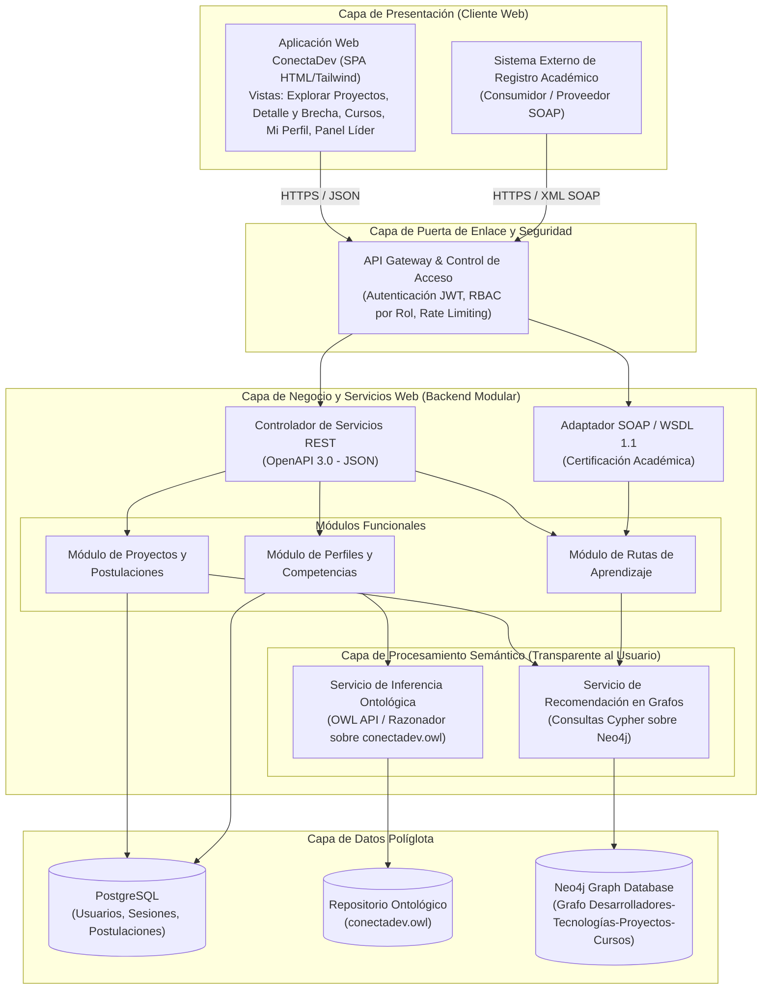
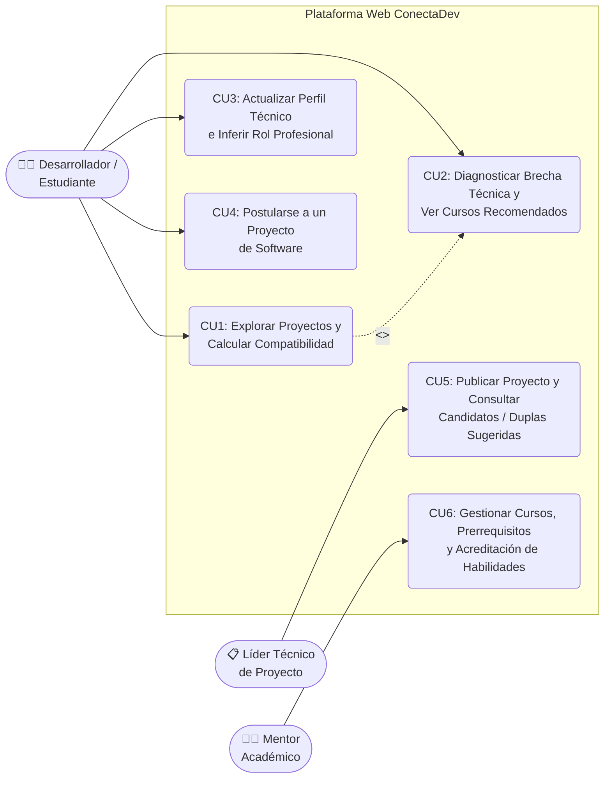
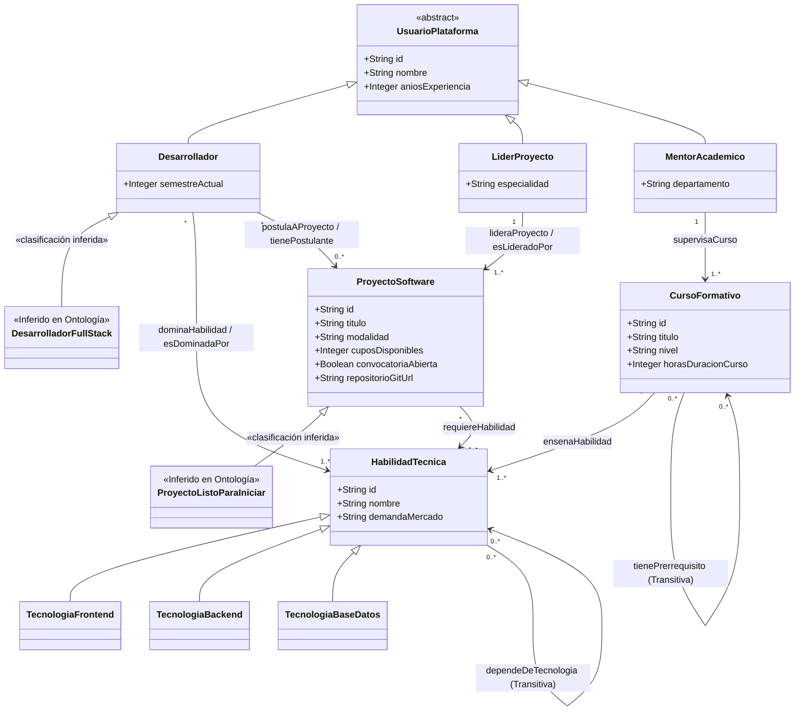
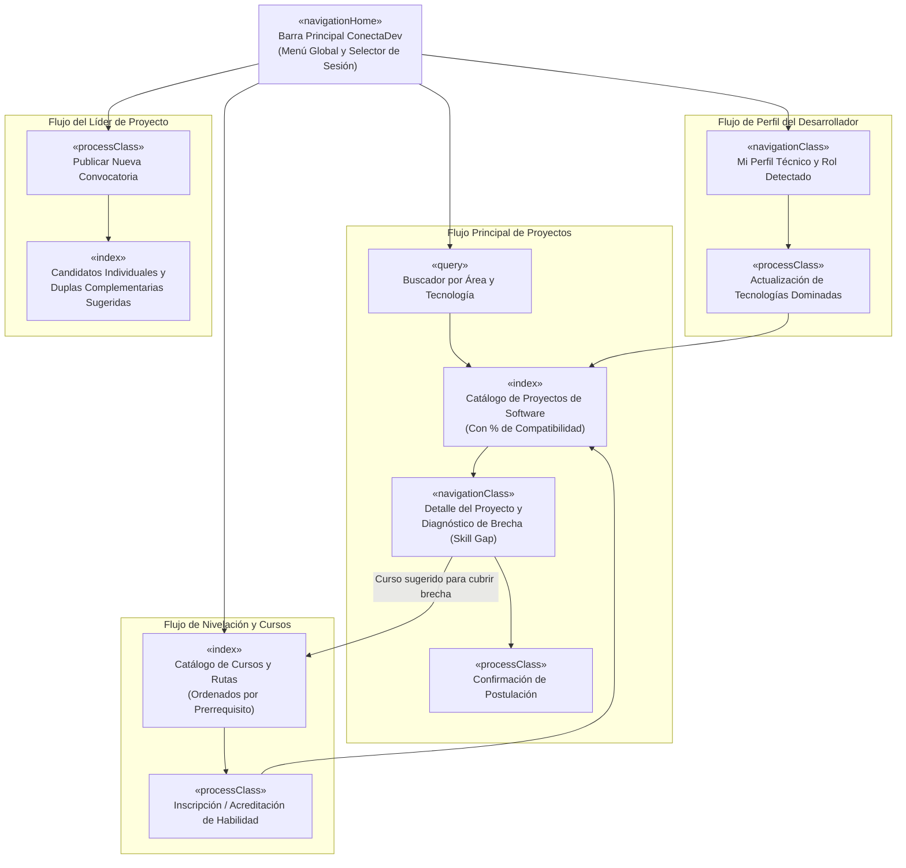
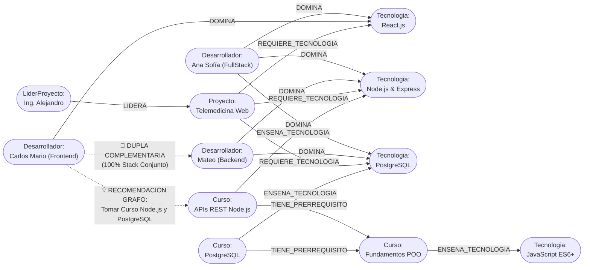

# PROYECTO FINAL DE CURSO: INGENIERÍA WEB (PERIODO 2620)
## **ConectaDev: Plataforma Web Conceptual y Semántica para la Vinculación de Proyectos de Software, Diagnóstico de Brechas Técnicas y Rutas de Aprendizaje**

**Institución:** Universidad Cooperativa de Colombia  
**Curso:** Ingeniería Web — Periodo 2620  
**Integrantes del Equipo:**
- **Andrés Hurtado**
- **Samuel Pineda**
- **Viviana Roa**

**Repositorio / Entregables del Proyecto:**
- Ontología OWL 2 DL: [`ontologia/conectadev.owl`](file:///C:/Users/Andres%20Hurtado/Documents/Ing%20Web/ontologia/conectadev.owl) y [`ontologia/GUIA_PROTEGE.md`](file:///C:/Users/Andres%20Hurtado/Documents/Ing%20Web/ontologia/GUIA_PROTEGE.md)
- Grafo de Conocimiento Neo4j: [`neo4j/conectadev_grafo.cypher`](file:///C:/Users/Andres%20Hurtado/Documents/Ing%20Web/neo4j/conectadev_grafo.cypher) y [`neo4j/GUIA_NEO4J.md`](file:///C:/Users/Andres%20Hurtado/Documents/Ing%20Web/neo4j/GUIA_NEO4J.md)
- Contratos de Servicios Web: [`servicios-web/openapi.yaml`](file:///C:/Users/Andres%20Hurtado/Documents/Ing%20Web/servicios-web/openapi.yaml) (REST) y [`servicios-web/validacion_academica.wsdl`](file:///C:/Users/Andres%20Hurtado/Documents/Ing%20Web/servicios-web/validacion_academica.wsdl) (SOAP/WSDL)
- Prototipo Navegable Interactivo: [`prototipo/index.html`](file:///C:/Users/Andres%20Hurtado/Documents/Ing%20Web/prototipo/index.html)

---

## 4.1 Formulación del Problema

### 1. Descripción del Problema
En los programas universitarios de Ingeniería de Software y comunidades tecnológicas estudiantiles (semilleros de investigación, proyectos integradores e iniciativas de innovación abierta), existe una **desconexión entre las habilidades técnicas de los estudiantes, los requisitos tecnológicos de los proyectos de software y los cursos de nivelación disponibles**.

Un sistema CRUD tradicional resulta insuficiente para resolver este problema porque solo realiza búsquedas por coincidencia literal de texto y no comprende relaciones semánticas del dominio de la Ingeniería de Software:
1. **Clasificación automática de perfiles:** No puede inferir por sí mismo cuándo un estudiante que domina tecnologías tanto de interfaz (`React.js`) como de servidor (`Node.js`) cumple formalmente el perfil de `DesarrolladorFullStack`, ni cuándo un proyecto que ya tiene postulantes activos pasa al estado `ProyectoListoParaIniciar`.
2. **Diagnóstico de brechas (*Skill Gap*) y recomendación de cursos:** Cuando a un estudiante le interesa un proyecto pero le falta una tecnología del stack (por ejemplo, sabe *React* pero le falta *Node.js* y *PostgreSQL*), un CRUD no descubre qué cursos formativos cubren exactamente las tecnologías faltantes.
3. **Dependencias tecnológicas y prerrequisitos transitivos:** No modela que dominar *Next.js* depende de *React.js* y este a su vez de *JavaScript*, ni que el curso de *Arquitectura FullStack* tiene como prerrequisito transitivo *APIs REST* y *Fundamentos de Programación*.
4. **Conformación de equipos complementarios:** No identifica parejas de desarrolladores cuyas habilidades combinadas (uno en Frontend y otro en Backend/Base de Datos) cubran el 100% del stack requerido por un proyecto.

### 2. Usuarios Involucrados (3 Tipos de Usuario — Mínimo exigido: 3)
1. **Desarrollador / Estudiante de Ingeniería (`Desarrollador`):** Registra las tecnologías que domina, explora proyectos de software conociendo su porcentaje de compatibilidad, consulta su ruta de cursos personalizada para cubrir brechas técnicas y se postula a proyectos.
2. **Líder Técnico de Proyecto (`LiderProyecto`):** Publica convocatorias de proyectos de software definiendo el stack tecnológico requerido y los cupos, y recibe recomendaciones tanto de candidatos individuales como de duplas complementarias (*Frontend + Backend*).
3. **Mentor / Coordinador Académico (`MentorAcademico`):** Gestiona y supervisa los cursos formativos, sus prerrequisitos académicos y las habilidades técnicas que cada curso acredita en el perfil de los estudiantes.

### 3. Objetivo de la Solución
Diseñar **ConectaDev**, una solución web conceptual y semántica que integre una arquitectura modular, una ontología de dominio en **Protégé (OWL 2 DL)** y un grafo de conocimiento en **Neo4j**, permitiendo emparejar desarrolladores con proyectos de software, inferir perfiles técnicos y recomendar rutas de aprendizaje personalizadas a través de una interfaz web intuitiva y servicios interoperables.

### 4. Alcance
El diseño comprende el modelado conceptual y navegacional bajo la metodología **UWE (UML-Based Web Engineering)**, la definición arquitectónica del sistema, la especificación de 6 servicios web REST (OpenAPI 3.0) y 1 servicio SOAP/WSDL para interoperabilidad con Registro Académico, la ontología OWL verificada con razonador en Protégé, el grafo de conocimiento en Neo4j con consultas Cypher de recomendación y un prototipo web navegable evaluado mediante las heurísticas de Nielsen. Utiliza únicamente información académica sintética y pública.

### 5. Funcionalidades Principales (6 Funcionalidades — Mínimo exigido: 5)
- **F1. Explorador de Proyectos de Software con Cálculo de Compatibilidad:** Catálogo interactivo que compara el stack del estudiante frente a las tecnologías exigidas por cada proyecto.
- **F2. Diagnóstico de Brechas Técnicas (*Skill Gap*) y Recomendador de Cursos:** Identifica qué tecnologías le faltan a un desarrollador para alcanzar el 100% en un proyecto y le sugiere los cursos exactos que enseñan esas tecnologías.
- **F3. Gestión de Perfil Técnico e Inferencia de Rol Profesional:** Permite al desarrollador actualizar sus habilidades y clasifica automáticamente su perfil (ej. `DesarrolladorFullStack`).
- **F4. Publicación de Convocatorias de Proyectos de Software:** Permite a los líderes técnicos registrar nuevos proyectos vinculando las habilidades requeridas y el repositorio Git.
- **F5. Recomendación de Candidatos y Duplas Complementarias de Desarrollo:** Sugiere al líder del proyecto tanto desarrolladores individuales compatibles como parejas complementarias (*Frontend + Backend*).
- **F6. Gestión de Rutas Formativas y Cadena de Prerrequisitos:** Visualización estructurada de cursos por nivel supervisados por mentores académicos.

### 6. Justificación de por qué el problema requiere una Solución Web
Los estudiantes, docentes líderes de semilleros y mentores interactúan de manera distribuida desde distintos campus, laboratorios y dispositivos. Una plataforma web centraliza en tiempo real las convocatorias de proyectos, enlaza repositorios Git externos mediante URLs estándar, expone APIs REST para el portal interactivo y permite interoperar mediante SOAP con el sistema institucional de registro académico sin requerir instalaciones locales.

---

## 4.2 Fundamentación Académica (Decisiones Basadas en Literatura)

Las decisiones de diseño de **ConectaDev** se fundamentan en las siguientes **6 fuentes académicas**:

1. **Ingeniería Web y Metodología UWE — Koch, N., & Kraus, A. (2002).** *The expressive power of UML-based Web Engineering.* En *Second International Workshop on Web-Oriented Software Technology (IWWOST)*.
   - **Aplicación en el proyecto:** Sustenta la separación entre el **Modelo Conceptual**, el **Modelo Navegacional** (`<<navigationClass>>`, `<<index>>`, `<<query>>`, `<<processClass>>`) y el **Prototipo de Presentación** (secciones 4.4 y 4.5), garantizando que el usuario final interactúe con pantallas limpias sin ver la complejidad interna del motor semántico.
2. **Ontologías e Inferencia en la Web Semántica — Horrocks, I., Patel-Schneider, P. F., & Van Harmelen, F. (2003).** *From SHIQ and RDF to OWL: The making of a Web Ontology Language.* *Journal of Web Semantics*, 1(1), 7–26.
   - **Aplicación en el proyecto:** Fundamenta el uso de axiomas de equivalencia (`owl:equivalentClass`), propiedades inversas (`owl:inverseOf`) y propiedades transitivas (`owl:TransitiveProperty`) en [`conectadev.owl`](file:///C:/Users/Andres%20Hurtado/Documents/Ing%20Web/ontologia/conectadev.owl) para deducir `DesarrolladorFullStack`, `ProyectoListoParaIniciar` y la cadena de prerrequisitos entre cursos.
3. **Construcción Sistemática de Ontologías — Noy, N. F., & McGuinness, D. L. (2001).** *Ontology Development 101: A Guide to Creating Your First Ontology.* Stanford Knowledge Systems Laboratory Technical Report KSL-01-05.
   - **Aplicación en el proyecto:** Guía la definición de las **Preguntas de Competencia (PC1–PC5)**, la taxonomía de `HabilidadTecnica` (`TecnologiaFrontend`, `TecnologiaBackend`, `TecnologiaBaseDatos`) y las restricciones de dominio y rango en la sección 4.7.
4. **Grafos de Conocimiento y Sistemas de Recomendación — Hogan, A., Blomqvist, E., Cochez, M., et al. (2021).** *Knowledge Graphs.* *ACM Computing Surveys (CSUR)*, 54(4), 1–37.
   - **Aplicación en el proyecto:** Justifica la representación en **Neo4j** (sección 4.8) para ejecutar consultas Cypher de recorrido multi-salto que conectan `Desarrollador -> Tecnologia <- Proyecto -> TecnologiaFaltante <- Curso` y descubren duplas de trabajo complementarias.
5. **Arquitectura de Servicios Web y Diseño de Sistemas de Datos — Fielding, R. T. (2000)** (*Architectural Styles and the Design of Network-based Software Architectures*, UC Irvine) **& Kleppmann, M. (2017)** (*Designing Data-Intensive Applications*, O'Reilly).
   - **Aplicación en el proyecto:** Fundamenta el diseño de servicios **REST** desacoplados en formato JSON (sección 4.6), la interoperabilidad **SOAP/WSDL** con sistemas legados universitarios y la arquitectura de persistencia políglota en la sección 4.3.
6. **Ingeniería de Usabilidad y Evaluación Heurística — Nielsen, J. (1994).** *Usability Engineering.* Morgan Kaufmann.
   - **Aplicación en el proyecto:** Sustenta el diseño centrado en el usuario del prototipo [`prototipo/index.html`](file:///C:/Users/Andres%20Hurtado/Documents/Ing%20Web/prototipo/index.html), ocultando los detalles técnicos de OWL/Cypher tras indicadores visuales claros de porcentaje de compatibilidad, barras de progreso y recomendaciones en lenguaje natural.

---

## 4.3 Arquitectura Web

### 1. Parámetros y Decisiones Arquitectónicas (ADR-001)

| Parámetro Arquitectónico | Definición para ConectaDev | Justificación Técnica |
| :--- | :--- | :--- |
| **Estilo Arquitectónico** | **Arquitectura en Capas / Monolito Modular con Persistencia Políglota** | Ideal para un equipo académico de hasta 4 integrantes; separa claramente la interfaz web, la lógica de aplicación, el motor semántico y el almacenamiento. |
| **Relación Lectura/Escritura** | **Ratio 80:20 (Lectura:Escritura)** • Pico estimado: **100 QPS (p99)** | La exploración de proyectos, cálculo de brechas y consulta de rutas de aprendizaje predomina sobre la creación de convocatorias. |
| **Metas de Nivel de Servicio (SLO)** | **Latencia p95: 120 ms • p99: 300 ms** • **Disponibilidad: 99.5%** | Garantiza respuesta inmediata al filtrar proyectos o recalcular compatibilidad cuando el estudiante actualiza sus habilidades. |
| **Recuperación (RPO / RTO)** | **RPO $\le 15\text{ min}$** • **RTO $\le 30\text{ min}$** | Respaldo periódico de postulaciones, perfiles estudiantiles y catálogo de proyectos. |

### 2. Diagrama de Componentes de la Arquitectura Web

### 3. Responsabilidad de Cada Componente
1. **Capa de Presentación (Aplicación Web ConectaDev):** Ofrece una experiencia de usuario limpia y comprensible para estudiantes, líderes y mentores. Consume los endpoints REST y muestra porcentajes de afinidad, tecnologías cumplidas/faltantes y cursos recomendados sin exponer código ontológico ni consultas de base de datos.
2. **API Gateway y Seguridad:** Gestiona la autenticación mediante tokens JWT, verifica los permisos según el rol (`Desarrollador`, `LiderProyecto`, `MentorAcademico`) y valida la estructura de las peticiones entrantes.
3. **Módulos de Negocio (`Proyectos`, `Perfiles`, `Rutas`):** Coordinan el registro de proyectos, la postulación de estudiantes y la actualización del portafolio de habilidades.
4. **Servicio de Inferencia Ontológica:** Opera en el backend sobre el modelo formal [`conectadev.owl`](file:///C:/Users/Andres%20Hurtado/Documents/Ing%20Web/ontologia/conectadev.owl) para deducir clasificaciones de perfil (`DesarrolladorFullStack`), estados de proyecto (`ProyectoListoParaIniciar`) y cadenas transitivas de prerrequisitos.
5. **Servicio de Recomendación en Grafos (Neo4j):** Ejecuta en el backend las consultas Cypher que calculan el porcentaje de compatibilidad, detectan brechas de habilidades y sugieren duplas complementarias de trabajo.
6. **Adaptador SOAP/WSDL:** Permite interoperar formalmente con el Sistema de Registro Académico de la universidad para validar prerrequisitos y acreditar cursos aprobados.

### 4. Justificación de Atributos de Calidad
- **Usabilidad:** El desacoplamiento total entre la capa semántica del backend y la capa de presentación permite que la interfaz web hable el lenguaje natural del estudiante y del profesor (*"67% Compatible"*, *"Falta: Node.js"*, *"Curso recomendado"*), evitando abrumar al usuario con formalismos de Protégé o Neo4j.
- **Mantenibilidad:** Las reglas de clasificación de perfiles y las dependencias entre tecnologías están declaradas en la ontología y en el grafo; agregar un nuevo framework o curso no requiere modificar la lógica de los controladores web.
- **Seguridad:** Separación de permisos por rol (RBAC), validación estricta de entradas mediante esquemas OpenAPI 3.0 y XML Schema (XSD), y comunicación cifrada sobre HTTPS.
- **Escalabilidad:** La arquitectura modular permite escalar de forma independiente el motor de consultas de recomendación en Neo4j frente a las operaciones transaccionales en PostgreSQL.

---

## 4.4 Metodología de Ingeniería Web: UWE (UML-Based Web Engineering)

Se aplicó la metodología **UWE (UML-Based Web Engineering)** porque estructura el diseño de aplicaciones web separando qué información maneja el dominio (**Modelo Conceptual**), cómo se recorre (**Modelo Navegacional**) y cómo se visualiza (**Modelo de Presentación / Prototipo**).

### 1. Fases, Actividades, Productos y Relación con los Usuarios

| Fase de UWE | Actividades Realizadas | Productos Obtenidos | Relación con las Necesidades de los Usuarios |
| :--- | :--- | :--- | :--- |
| **1. Análisis de Requisitos** | Identificación de los 3 actores académicos, definición de las 6 funcionalidades y formulación de las preguntas de competencia. | Especificación del problema, actores y Diagrama de Casos de Uso (Sección 4.5). | Recoge las necesidades reales de los estudiantes al buscar proyectos y de los líderes al conformar equipos. |
| **2. Diseño Conceptual (Contenido)** | Modelado de las clases del dominio de Ingeniería de Software y su formalización en la ontología OWL y el grafo Neo4j. | **Modelo Conceptual del Dominio**, [`conectadev.owl`](file:///C:/Users/Andres%20Hurtado/Documents/Ing%20Web/ontologia/conectadev.owl) y [`conectadev_grafo.cypher`](file:///C:/Users/Andres%20Hurtado/Documents/Ing%20Web/neo4j/conectadev_grafo.cypher). | Representa con precisión las relaciones entre habilidades, proyectos, cursos y prerrequisitos. |
| **3. Diseño Navegacional** | Diseño de los nodos navegacionales, índices de proyectos, filtros de búsqueda y flujos de postulación y nivelación. | **Modelo Navegacional UWE** (Sección 4.5). | Garantiza que el estudiante pase en un clic del proyecto que le interesa al curso que necesita para nivelarse. |
| **4. Diseño de Presentación y Servicios** | Construcción del prototipo web limpio y especificación de los contratos REST y SOAP. | Prototipo [`prototipo/index.html`](file:///C:/Users/Andres%20Hurtado/Documents/Ing%20Web/prototipo/index.html), [`openapi.yaml`](file:///C:/Users/Andres%20Hurtado/Documents/Ing%20Web/servicios-web/openapi.yaml) y [`validacion_academica.wsdl`](file:///C:/Users/Andres%20Hurtado/Documents/Ing%20Web/servicios-web/validacion_academica.wsdl). | Entrega pantallas comprensibles, amigables y libres de jerga interna del motor semántico. |
| **5. Evaluación de Usabilidad y Verificación** | Inspección del prototipo con 6 Heurísticas de Nielsen y ejecución de pruebas en Protégé y Neo4j. | Tabla de evaluación heurística y guías de evidencia ([`GUIA_PROTEGE.md`](file:///C:/Users/Andres%20Hurtado/Documents/Ing%20Web/ontologia/GUIA_PROTEGE.md), [`GUIA_NEO4J.md`](file:///C:/Users/Andres%20Hurtado/Documents/Ing%20Web/neo4j/GUIA_NEO4J.md)). | Asegura coherencia visual, prevención de errores y exactitud en las recomendaciones. |

### 2. Ventajas y Limitaciones de UWE para el Proyecto
- **Ventajas:** Facilita una correspondencia limpia entre las clases del Modelo Conceptual y las entidades de la ontología OWL, además de ordenar los menús e índices de navegación por perfil de usuario.
- **Limitaciones:** Como UWE no modela nativamente axiomas de inferencia lógica (`owl:equivalentClass`), se complementó el modelo conceptual UML con la especificación formal en Protégé.

---

## 4.5 Modelado y Usabilidad

### 1. Actores y Perfiles de Usuario
| Actor | Descripción del Perfil | Objetivo Principal en ConectaDev |
| :--- | :--- | :--- |
| **Desarrollador / Estudiante** | Estudiante de Ingeniería de Software (semestres 1 a 10) con conocimientos parciales o avanzados en programación. | Encontrar proyectos donde aplicar sus habilidades, identificar qué tecnologías le faltan y tomar cursos para completar su perfil. |
| **Líder Técnico de Proyecto** | Docente investigador o coordinador de semillero que dirige el desarrollo de un producto de software. | Publicar convocatorias de proyectos indicando el stack requerido y seleccionar candidatos o duplas complementarias. |
| **Mentor Académico** | Docente encargado de las rutas de formación complementaria y nivelación técnica. | Estructurar los cursos cortos, definir sus prerrequisitos y acreditar las habilidades adquiridas por los estudiantes. |

### 2. Casos de Uso / Funcionalidades Principales

### 3. Modelo Conceptual del Dominio

### 4. Modelo Navegacional (UWE)

### 5. Prototipo Navegable de las Interfaces Principales
El prototipo interactivo está disponible en [`prototipo/index.html`](file:///C:/Users/Andres%20Hurtado/Documents/Ing%20Web/prototipo/index.html) e implementa las **5 pantallas principales** con un diseño 100% limpio y centrado en el usuario final:
1. **Explorar Proyectos:** Muestra cada convocatoria con barra visual de compatibilidad, tecnologías que el usuario ya domina en verde (`✓ React.js`) y tecnologías faltantes en ámbar (`Falta: Node.js`).
2. **Detalle del Proyecto y Ruta de Nivelación:** Separa las habilidades cumplidas de las habilidades por aprender y enlaza directamente los cursos recomendados para cubrir la brecha.
3. **Cursos y Rutas de Aprendizaje:** Presenta la secuencia formativa ordenada por niveles (*Paso 1 $\rightarrow$ Paso 2 $\rightarrow$ Paso 3*) indicando explícitamente sus prerrequisitos.
4. **Mi Perfil Técnico:** Permite marcar o desmarcar tecnologías y observar cómo cambia inmediatamente el perfil detectado (*Desarrollador Frontend* $\rightarrow$ *Desarrollador FullStack*) y los porcentajes de compatibilidad.
5. **Gestión de Líder de Proyecto:** Permite publicar un nuevo proyecto y visualizar tanto candidatos 100% compatibles como **duplas complementarias sugeridas**.

### 6. Evaluación del Prototipo mediante Heurísticas de Nielsen y Mejoras Aplicadas

| # | Heurística de Jakob Nielsen | Problema Detectado en el Diseño Inicial | Mejora Aplicada en el Prototipo Final (`prototipo/index.html`) |
| :---: | :--- | :--- | :--- |
| **H1** | **Visibilidad del estado del sistema** | El estudiante no sabía en qué sección se encontraba ni cuántas habilidades activas estaban siendo tomadas en cuenta para calcular su compatibilidad. | Se incorporó una barra de ubicación (*breadcrumbs*), resaltado de pestaña activa, barra de progreso porcentual en cada tarjeta y resumen superior con el rol detectado y número de tecnologías activas. |
| **H2** | **Relación entre el sistema y el mundo real** | En una iteración previa se exponían términos internos de desarrollo semántico (nombres de razonadores, axiomas OWL y rutas de API) que no pertenecen al vocabulario de un usuario final. | Se eliminó toda jerga interna de Protégé/Neo4j de la interfaz, reemplazándola por lenguaje natural de Ingeniería de Software: *"67% Compatible"*, *"Habilidades que ya cumples"*, *"Habilidades por aprender"* y *"Dupla Complementaria Sugerida"*. |
| **H3** | **Control y libertad del usuario** | Al hacer clic en "Postularme" o entrar al detalle de un proyecto, no existía opción clara de cancelar o regresar al listado sin recargar la página. | Se añadió el enlace `← Volver al catálogo de proyectos` en la vista de detalle y un modal de confirmación con botón explícito `Cancelar` antes de enviar cualquier postulación. |
| **H4** | **Consistencia y estándares** | Los colores de las etiquetas tecnológicas no diferenciaban cuáles habilidades ya dominaba el estudiante y cuáles le faltaban. | Se estandarizó el código visual en toda la aplicación: **verde esmeralda** para habilidades ya dominadas/compatibles, **ámbar** para habilidades faltantes (brechas) e **índigo** para acciones principales. |
| **H5** | **Prevención de errores** | En el formulario del Líder de Proyecto era posible intentar crear un proyecto sin tecnologías asociadas o con cupos inválidos. | Se reemplazó la entrada libre de tecnologías por casillas de selección verificadas, validación de al menos una tecnología obligatoria y restricción numérica de cupos (`min="1" max="8"`). |
| **H6** | **Reconocer antes que recordar** | El estudiante tenía que memorizar qué tecnologías le faltaban en un proyecto e ir a buscarlas manualmente en el catálogo de cursos. | En la pantalla de detalle de cada proyecto se incluyó el panel lateral **"Cursos Recomendados para ti"**, mostrando directamente el curso que cubre cada tecnología faltante sin obligar al usuario a buscarlo. |

---

## 4.6 Servicios Web (Enfoque REST y Representación SOAP/WSDL)

### 1. Especificación de Servicios REST ([`servicios-web/openapi.yaml`](file:///C:/Users/Andres%20Hurtado/Documents/Ing%20Web/servicios-web/openapi.yaml))

| ID | Recurso / Endpoint REST | Método HTTP | Propósito | Datos de Entrada | Datos de Salida (JSON) | Usuario / Componente que lo Utiliza |
| :---: | :--- | :---: | :--- | :--- | :--- | :--- |
| **S1** | `/v1/proyectos` | `GET` | Consultar el catálogo de proyectos abiertos con porcentaje de compatibilidad. | Query params: `areaTecnologica`, `tecnologiaId`, `soloConvocatoriaAbierta`. | Lista de `ProyectoDTO` con tecnologías requeridas y `porcentajeCompatibilidadUsuario`. | **Desarrollador** / Vista Explorar Proyectos. |
| **S2** | `/v1/proyectos` | `POST` | Publicar una nueva convocatoria de proyecto de software. | Body JSON: `titulo`, `modalidad`, `liderId`, `tecnologiasRequeridas`, `cuposDisponibles`, `repositorioGitUrl`. | `201 Created` con los datos del proyecto registrado. | **Líder de Proyecto** / Panel de Gestión de Líder. |
| **S3** | `/v1/proyectos/{proyectoId}/brecha-habilidades` | `GET` | Diagnosticar habilidades cumplidas vs. faltantes y recomendar cursos de nivelación. | Path: `proyectoId`; Query: `desarrolladorId`. | `habilidadesCumplidas`, `habilidadesFaltantes` y lista de `cursosRecomendados` con su prerrequisito. | **Desarrollador** / Vista Detalle del Proyecto y motor Neo4j. |
| **S4** | `/v1/desarrolladores/{desarrolladorId}/perfil` | `PUT` | Actualizar las tecnologías dominadas por el estudiante y reclasificar su perfil. | Path: `desarrolladorId`; Body JSON: `semestreActual`, `aniosExperiencia`, `habilidadesDominadasIds`. | Perfil actualizado e inferencia ontológica del rol (`DesarrolladorFullStack`). | **Desarrollador** / Vista Mi Perfil Técnico y motor OWL. |
| **S5** | `/v1/proyectos/{proyectoId}/candidatos-sugeridos` | `GET` | Obtener candidatos individuales compatibles y duplas complementarias para un proyecto. | Path: `proyectoId`. | Lista de `candidatosIndividuales` y `duplasComplementarias` (*Frontend + Backend*). | **Líder de Proyecto** / Recomendador de Equipos en Neo4j. |
| **S6** | `/v1/postulaciones` | `POST` | Registrar la postulación de un desarrollador a un proyecto de software. | Body JSON: `desarrolladorId`, `proyectoId`, `mensajeMotivacion`. | `201 Created` con `postulacionId`, estado y actualización del proyecto a `ProyectoListoParaIniciar`. | **Desarrollador** / Modal de Confirmación de Postulación. |

### 2. Representación de un Servicio mediante SOAP/WSDL ([`servicios-web/validacion_academica.wsdl`](file:///C:/Users/Andres%20Hurtado/Documents/Ing%20Web/servicios-web/validacion_academica.wsdl))
Para la integración formal con el **Sistema Institucional de Registro y Control Académico de la Universidad** (que suele operar sobre arquitecturas empresariales legadas basadas en XML), el servicio de **Verificación de Prerrequisitos y Certificación de Cursos Aprobados** se diseñó bajo el estándar **SOAP 1.1 / WSDL 1.1**:
- **Operación WSDL:** `VerificarCertificacionCurso` definida en `ValidacionAcademicaPortType`.
- **Mensaje de Entrada (`VerificarCertificacionCursoRequest`):** Envía `codigoEstudiante`, `codigoCursoFormativo`, `codigoMentorSupervisor` y `calificacionObtenida`.
- **Mensaje de Salida (`VerificarCertificacionCursoResponse`):** Retorna `folioRegistroAcademico`, `prerrequisitosCumplidos` (`xsd:boolean`), `habilidadTecnicaAcreditada` y `perfilProfesionalActualizado`.
- **Manejo de Errores (`soap:Fault`):** Define el elemento `FalloValidacionAcademica` cuando el estudiante intenta certificar un curso avanzado sin haber cursado su prerrequisito transitivo.

---

## 4.7 Ontología del Dominio (Construida en Protégé: [`ontologia/conectadev.owl`](file:///C:/Users/Andres%20Hurtado/Documents/Ing%20Web/ontologia/conectadev.owl))

La ontología modela formalmente el dominio en OWL 2 DL, cumpliendo y superando todos los criterios de la guía:

### 1. Clases (12 Clases — Mínimo exigido: 8)
1. `UsuarioPlataforma`
2. `Desarrollador` ($\sqsubseteq \text{UsuarioPlataforma}$)
3. `DesarrolladorFullStack` ($\equiv \text{Clase Definida Inferida}$)
4. `LiderProyecto` ($\sqsubseteq \text{UsuarioPlataforma}$)
5. `MentorAcademico` ($\sqsubseteq \text{UsuarioPlataforma}$)
6. `ProyectoSoftware`
7. `ProyectoListoParaIniciar` ($\equiv \text{Clase Definida Inferida}$)
8. `HabilidadTecnica`
9. `TecnologiaFrontend` ($\sqsubseteq \text{HabilidadTecnica}$)
10. `TecnologiaBackend` ($\sqsubseteq \text{HabilidadTecnica}$)
11. `TecnologiaBaseDatos` ($\sqsubseteq \text{HabilidadTecnica}$)
12. `CursoFormativo`

### 2. Propiedades de Objeto con Dominio y Rango (11 Propiedades — Mínimo exigido: 10)
1. `dominaHabilidad` (Dominio: `Desarrollador` $\rightarrow$ Rango: `HabilidadTecnica`)
2. `esDominadaPor` (Inversa de `dominaHabilidad`)
3. `requiereHabilidad` (Dominio: `ProyectoSoftware` $\rightarrow$ Rango: `HabilidadTecnica`)
4. `lideraProyecto` (Dominio: `LiderProyecto` $\rightarrow$ Rango: `ProyectoSoftware`)
5. `esLideradoPor` (Inversa de `lideraProyecto`)
6. `postulaAProyecto` (Dominio: `Desarrollador` $\rightarrow$ Rango: `ProyectoSoftware`)
7. `tienePostulante` (Inversa de `postulaAProyecto`)
8. `ensenaHabilidad` (Dominio: `CursoFormativo` $\rightarrow$ Rango: `HabilidadTecnica`)
9. `supervisaCurso` (Dominio: `MentorAcademico` $\rightarrow$ Rango: `CursoFormativo`)
10. `tienePrerrequisito` (Dominio: `CursoFormativo` $\rightarrow$ Rango: `CursoFormativo`, **`owl:TransitiveProperty`**)
11. `dependeDeTecnologia` (Dominio: `HabilidadTecnica` $\rightarrow$ Rango: `HabilidadTecnica`, **`owl:TransitiveProperty`**)

### 3. Propiedades de Datos con Dominio y Rango (6 Propiedades — Mínimo exigido: 5)
1. `semestreActual` (`Desarrollador` $\rightarrow$ `xsd:integer`)
2. `aniosExperiencia` (`UsuarioPlataforma` $\rightarrow$ `xsd:integer`)
3. `horasDuracionCurso` (`CursoFormativo` $\rightarrow$ `xsd:integer`)
4. `cuposDisponibles` (`ProyectoSoftware` $\rightarrow$ `xsd:integer`)
5. `repositorioGitUrl` (`ProyectoSoftware` $\rightarrow$ `xsd:string`)
6. `convocatoriaAbierta` (`ProyectoSoftware` $\rightarrow$ `xsd:boolean`)

### 4. Restricciones Lógicas (4 Restricciones — Mínimo exigido: 3)
1. **Restricción Existencial Frontend en `DesarrolladorFullStack`:** $\exists \text{dominaHabilidad}.\text{TecnologiaFrontend}$
2. **Restricción Existencial Backend en `DesarrolladorFullStack`:** $\exists \text{dominaHabilidad}.\text{TecnologiaBackend}$
3. **Restricción Existencial de Stack en `ProyectoSoftware`:** $\text{ProyectoSoftware} \sqsubseteq \exists \text{requiereHabilidad}.\text{HabilidadTecnica}$
4. **Restricción Combinada (`someValuesFrom` + `hasValue`) en `ProyectoListoParaIniciar`:** $\text{ProyectoSoftware} \sqcap (\exists \text{tienePostulante}.\text{Desarrollador}) \sqcap (\ni \text{convocatoriaAbierta}.\{\text{true}\})$

### 5. Individuos (15 Individuos — Mínimo exigido: 8)
`Tech_JavaScript`, `Tech_React`, `Tech_NextJS`, `Tech_NodeJS`, `Tech_SpringBoot`, `Tech_PostgreSQL`, `Curso_FundamentosPOO`, `Curso_APIsREST_NodeJS`, `Curso_ArquitecturaFullStack`, `Dev_AnaSofia`, `Dev_CarlosMario`, `Lider_IngAlejandro`, `Mentor_DraElena`, `Proy_PlataformaTelemedicina` y `Proy_PasarelaPagosFinTech`.

### 6. Preguntas de Competencia y Explicación de Inferencias Derivadas
Las **5 preguntas de competencia** (detalladas con sus consultas en [`ontologia/GUIA_PROTEGE.md`](file:///C:/Users/Andres%20Hurtado/Documents/Ing%20Web/ontologia/GUIA_PROTEGE.md)) se validan ejecutando el razonador **HermiT**, el cual comprueba la consistencia total de la ontología y produce las siguientes inferencias clave:
- **Inferencia Derivada 1 (`DesarrolladorFullStack`):** `Dev_AnaSofia` fue declarada únicamente como `Desarrollador`. Al dominar `Tech_React` (`TecnologiaFrontend`) y `Tech_NodeJS` (`TecnologiaBackend`), el razonador infiere automáticamente que pertenece a la clase `DesarrolladorFullStack`. En cambio, `Dev_CarlosMario` (que solo domina tecnologías Frontend) no es clasificado como FullStack.
- **Inferencia Derivada 2 (`ProyectoListoParaIniciar` e Inversas):** Como `Dev_AnaSofia` tiene la propiedad `postulaAProyecto Proy_PlataformaTelemedicina`, el razonador deduce la propiedad inversa `tienePostulante Dev_AnaSofia`. Al combinarse con `convocatoriaAbierta = true`, el razonador clasifica automáticamente a `Proy_PlataformaTelemedicina` dentro de `ProyectoListoParaIniciar`.
- **Inferencia Derivada 3 (Transitividad de Prerrequisitos y Dependencias):** El razonador deduce automáticamente que `Curso_ArquitecturaFullStack tienePrerrequisito Curso_FundamentosPOO` y que `Tech_NextJS dependeDeTecnologia Tech_JavaScript`.

---

## 4.8 Grafo de Conocimiento en Neo4j (Implementado en [`neo4j/conectadev_grafo.cypher`](file:///C:/Users/Andres%20Hurtado/Documents/Ing%20Web/neo4j/conectadev_grafo.cypher))

### 1. Representación del Grafo (16 Nodos y 26 Relaciones — Mínimo exigido: 8 nodos y 10 relaciones)

### 2. Consultas en Cypher Relacionadas con Necesidades del Proyecto
El archivo [`neo4j/conectadev_grafo.cypher`](file:///C:/Users/Andres%20Hurtado/Documents/Ing%20Web/neo4j/conectadev_grafo.cypher) contiene **4 consultas Cypher**:
1. **Consulta 1 (Cálculo de Compatibilidad Desarrollador–Proyecto):** Compara el subconjunto de tecnologías que domina cada desarrollador frente al total de tecnologías requeridas por cada proyecto abierto, calculando el porcentaje exacto de cobertura.
2. **Consulta 2 (Recomendación de Conocimiento No Registrado — Cierre de Brechas con Cursos):** Para un estudiante como `Carlos Mario Restrepo` (`DEV-02`) que desea participar en el proyecto de `Telemedicina` pero solo domina `React.js`, la consulta identifica las tecnologías faltantes (`Node.js & Express` y `PostgreSQL`) y recorre el grafo hacia los nodos `:Curso` que enseñan dichas tecnologías, recomendándole la ruta formativa exacta y su prerrequisito.
3. **Consulta 3 (Recomendación de Conocimiento Implícito — Duplas Complementarias):** Descubre que aunque `Carlos Mario Restrepo` (Frontend) y `Mateo Fernández` (Backend & Datos) no tienen relación directa ni cubren por separado el 100% del proyecto `Telemedicina`, al unir sus habilidades cubren la totalidad del stack requerido (`DUPLA_COMPLEMENTARIA_100%_STACK`).
4. **Consulta 4 (Rutas Transitivas de Aprendizaje):** Recorre cadenas de longitud variable `[:TIENE_PRERREQUISITO*1..3]` sumando la carga horaria total de la ruta formativa.

---

## 4.9 Integración del Diseño

La solución propuesta integra de forma coherente y sin contradicciones todos los componentes del curso:

1. **Relación entre el Problema y las Funcionalidades:** La dificultad para vincular estudiantes con proyectos de software y nivelar sus brechas técnicas se atiende directamente con el catálogo de compatibilidad (**F1**), el recomendador de cursos por brecha (**F2**), la inferencia de perfil técnico (**F3**) y el recomendador de duplas complementarias (**F5**).
2. **Conexión entre el Modelo Conceptual y la Navegación:** Las clases del Modelo Conceptual (`ProyectoSoftware`, `Desarrollador`, `HabilidadTecnica`, `CursoFormativo`) se proyectan en el Modelo Navegacional UWE como índices y vistas interconectadas, permitiendo que en el prototipo [`prototipo/index.html`](file:///C:/Users/Andres%20Hurtado/Documents/Ing%20Web/prototipo/index.html) el usuario navegue fluidamente desde un proyecto hacia los cursos que cubren sus tecnologías faltantes.
3. **Representación del Dominio en la Ontología:** La ontología [`conectadev.owl`](file:///C:/Users/Andres%20Hurtado/Documents/Ing%20Web/ontologia/conectadev.owl) formaliza en Protégé las reglas lógicas del dominio (como la definición axiomática de `DesarrolladorFullStack`, `ProyectoListoParaIniciar` y la transitividad de `tienePrerrequisito`), las cuales se ejecutan en el backend sin ensuciar la interfaz del usuario.
4. **Uso de los Conceptos del Modelo en los Servicios Web:** Los endpoints REST ([`openapi.yaml`](file:///C:/Users/Andres%20Hurtado/Documents/Ing%20Web/servicios-web/openapi.yaml)) y el contrato SOAP ([`validacion_academica.wsdl`](file:///C:/Users/Andres%20Hurtado/Documents/Ing%20Web/servicios-web/validacion_academica.wsdl)) operan sobre los mismos identificadores y propiedades definidos en el modelo conceptual (`tecnologiasRequeridas`, `habilidadesFaltantes`, `cursosRecomendados`, `perfilInferido`).
5. **Consulta e Inferencia en el Grafo de Conocimiento:** Mientras Protégé/OWL clasifica conceptos mediante lógica descriptiva, Neo4j ([`conectadev_grafo.cypher`](file:///C:/Users/Andres%20Hurtado/Documents/Ing%20Web/neo4j/conectadev_grafo.cypher)) aprovecha los caminos del grafo para calcular porcentajes de afinidad, recomendar cursos específicos ante brechas de habilidades y sugerir equipos de trabajo complementarios.
6. **Soporte de la Arquitectura a la Solución Completa:** La arquitectura modular en capas une el cliente web limpio con los servicios REST/SOAP y delega el razonamiento en los motores OWL y Neo4j, logrando una aplicación mantenible, usable y escalable.
